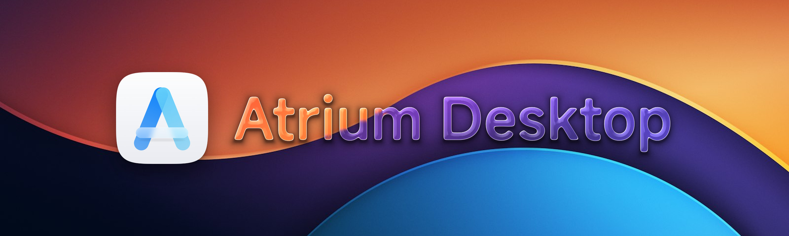
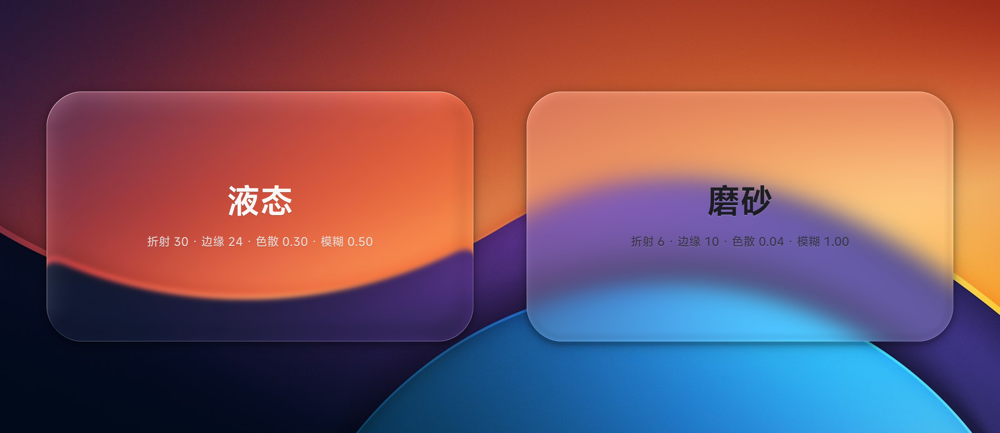
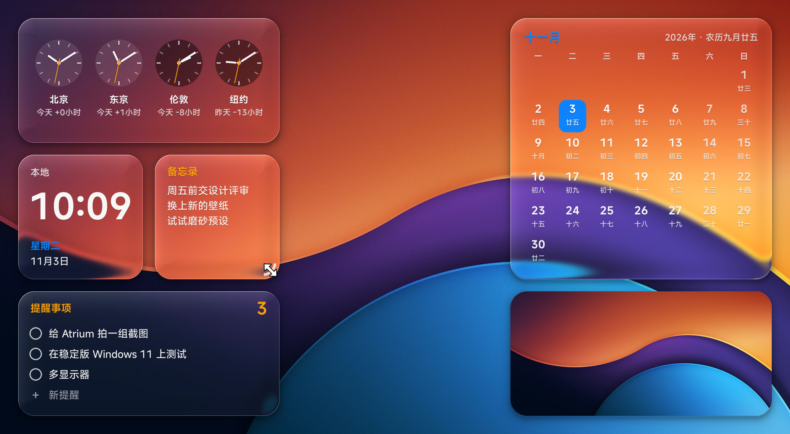
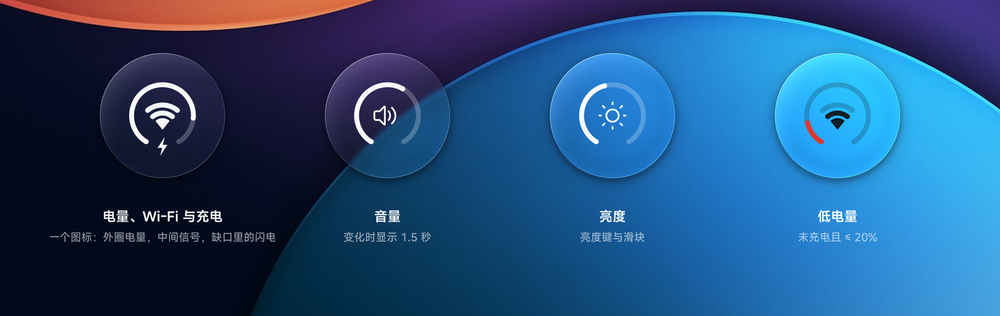
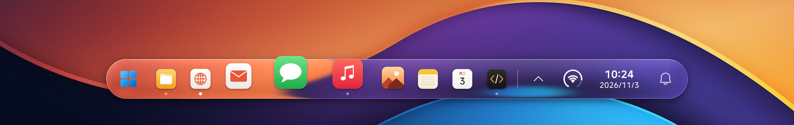

<p align="center">
  
</p>

<h1 align="center">Atrium Desktop</h1>

<p align="center">
  <b>为 Windows 11 重新做的一层桌面。</b><br>
  任务栏、开始菜单、控制中心、通知和桌面小组件，用的是同一块实时折射的玻璃、同一套动效和同一种字体。
</p>

<p align="center">
  <a href="#快速开始"><b>快速开始</b></a>&nbsp;&nbsp;·&nbsp;&nbsp;<a href="#设计语言"><b>设计语言</b></a>&nbsp;&nbsp;·&nbsp;&nbsp;<a href="#工程"><b>工程</b></a>&nbsp;&nbsp;·&nbsp;&nbsp;<a href="README_EN.md"><b>English</b></a>
</p>

<p align="center">
  <a href="https://github.com/wynter-yaxley/atrium-desktop/actions/workflows/build.yml"></a>
  
  
  
  <a href="LICENSE"></a>
</p>

<br>

## 不只是一条任务栏

Windows 的桌面是几代设计叠起来的：任务栏、托盘、开始菜单、通知、快捷设置，各有各的圆角、字号和动画。Atrium 把你每天看到的这一层整个重画了一遍，并且每一处都遵守同一套规则：

- **同一种材质。** 栏、每个弹出面板、每个右键菜单、每张通知卡片和每个小组件，用的都是同一个着色器、同一组参数。改一次透明度，整个桌面一起变。
- **同一套动效。** 弹出用弹簧，跟随指针用指数渐近。所有动画都可以中途打断，并且与帧率无关。
- **同一种字体。** 界面文字统一用 MiSans 的三个字重，数字一律等宽，玻璃上的小字会自动加重一档。

Explorer 和 Windows Shell 保持原样。Atrium 不向任何系统进程注入代码，不改系统文件，不装服务，也不需要管理员权限。它默认与系统任务栏共存；如果只想留下 Atrium，可以在设置中心隐藏系统任务栏，退出时会自动恢复。

<table>
  <tr>
    <td width="25%" valign="top"><b>任务栏</b><br><sub>悬浮的胶囊形玻璃栏。悬停时图标像程序坞一样波浪放大，固定与运行中的应用可以拖动排序。</sub></td>
    <td width="25%" valign="top"><b>开始菜单</b><br><sub>显示 Windows 开始菜单的固定项，直接打字就能搜索；分页排列，每页 7 × 3。</sub></td>
    <td width="25%" valign="top"><b>控制中心</b><br><sub>Wi-Fi、蓝牙、投屏与投影模式、亮度、声音输出设备、各应用音量。</sub></td>
    <td width="25%" valign="top"><b>日历</b><br><sub>点栏上的时钟打开，月历带农历和节日。</sub></td>
  </tr>
  <tr>
    <td valign="top"><b>通知</b><br><sub>每张卡片是一块独立的玻璃，向上堆叠，可以展开。也可以接入 Windows 通知、微信和飞书消息。</sub></td>
    <td valign="top"><b>托盘</b><br><sub>自绘的托盘面板。读取系统托盘图标，点击转发给应用本身。</sub></td>
    <td valign="top"><b>桌面小组件</b><br><sub>八类小组件，三种尺寸。网格吸附，拖动角上的握把改变尺寸。</sub></td>
    <td valign="top"><b>设置中心</b><br><sub>WinUI 3 三列工作区，中间是按真实参数渲染的实时预览。</sub></td>
  </tr>
</table>

<br>

## 一块玻璃，两种性格

<p align="center">
  
</p>

Atrium 的玻璃是一个基于符号距离场的像素着色器（[`glass.hlsl`](native/core/render/shaders/glass.hlsl)）。每一帧，它从桌面复制中取得玻璃背后的画面，然后依次计算：

1. **形状**：由圆角矩形的距离场求出边缘的法线，抗锯齿也由它完成。
2. **透镜**：在靠近边缘的一圈，按圆形截面把采样点往里推，画面在边缘处弯折。
3. **色散**：红、绿、蓝三个通道分别推远一点或推近一点，边缘出现很细的彩边。
4. **模糊与通透**：用背景的低分辨率 mip 加几次采样来模糊，再像 macOS 一样略微提高饱和度，最后混入色调。
5. **光**：迎光的一侧有一条锐利的高光线，内侧有一层柔光，顶部有一点光泽，外面是一圈柔和的投影。

液态和磨砂不是两套实现，只是同一条管线的两组参数：

| 参数 | 液态（默认） | 磨砂 |
| :--- | ---: | ---: |
| 透明度 | 0.95 | 0.80 |
| 模糊 | 0.50 | 1.00 |
| 折射 | 30 | 6 |
| 折射边缘宽度 | 24 | 10 |
| 色散 | 0.30 | 0.04 |
| 高光 | 0.80 | 0.45 |
| 色调 | `#FFFFFF` | `#F5F5FA` |

玻璃上的字色跟着背后的亮度变化：亮度高于 0.50 时换成深色字，低于 0.42 时换回浅色字。两个阈值之间保持不变，免得在临界亮度上来回闪烁；切换时有 450 ms 的渐变。字色按区域分别判断，所以栏左侧的图标和右侧的时钟可以一深一浅。

<br>

## 桌面小组件

<p align="center">
  
</p>

小组件是桌面上的第二层玻璃。设计参照 macOS Sonoma 之后的桌面小组件，但布局和层级按 Windows 的习惯重新做了。

<table>
  <tr>
    <td width="22%" valign="top"><b>网格</b></td>
    <td valign="top">格子边长 164，间距 16，离屏幕边缘 24。屏幕左右两半各自贴着边缘排列，两侧的边距相等。拖动时组件浮到最上，松手后吸附到最近的空位，用 240 ms 的缓出滑过去。</td>
  </tr>
  <tr>
    <td valign="top"><b>三种尺寸</b></td>
    <td valign="top">小 164 × 164，中 344 × 164，大 344 × 344。圆角 22，约为边长的 13%，与 macOS 小组件的比例相同。</td>
  </tr>
  <tr>
    <td valign="top"><b>拖角改尺寸</b></td>
    <td valign="top">指针移到组件上时，朝屏幕中间的那个下角会出现一段沿着圆角的弧形握把：比圆角内缩 6，线宽 3.5，用次要文字的颜色。拖动时以一格和两格的中点为界，选出离指针最近的尺寸，组件立即滑到这个尺寸；远离握把的上边和外侧边保持不动。</td>
  </tr>
  <tr>
    <td valign="top"><b>克制的颜色</b></td>
    <td valign="top">组件始终是透明的玻璃，文字用玻璃按区域取的墨色。只保留几处颜色：时钟的橙色秒针、电量环的绿色和红色、日历的强调色，以及世界时钟在夜间的深色表盘。</td>
  </tr>
  <tr>
    <td valign="top"><b>层级</b></td>
    <td valign="top">平时在桌面之上、所有窗口之下；按 Win+D 显示桌面时浮到最上。组件窗口只接受自己发起的 Z 序改动，所以别的窗口改大小、系统弹窗出现，都不会把它抬到窗口上面。</td>
  </tr>
  <tr>
    <td valign="top"><b>内容</b></td>
    <td valign="top">时钟（含世界时钟）、数字时钟、日历（大号月历每天都写农历）、电池、系统监视（CPU、内存、磁盘）、备忘录（可以直接输入，支持输入法）、提醒事项、照片（按 EXIF 方向摆正并居中裁切，每 10 分钟换一张）。</td>
  </tr>
  <tr>
    <td valign="top"><b>省电</b></td>
    <td valign="top">玻璃默认实时映出桌面。桌面变化时，每块组件最多每 100 ms 跟随一次；也可以切换到“静态壁纸”，只在换壁纸时重新合成。</td>
  </tr>
</table>

<br>

## 状态圆环

<p align="center">
  
</p>

栏的右侧不放一排电池、网络、音量图标，只放一个单色圆环。它参照 iPhone 的圆环状态栏，只保留两层：

- **外圈**是底部开口 64° 的圆环，从开口左端顺时针填充电量。底轨是淡墨，填充与栏上其他符号同色，不写数字。只有在未充电且电量不高于 20% 时，填充才变红。充电时，开口处有一道小闪电。
- **中心**是 iPhone 式的三格 Wi-Fi，由一个扇形和两道弧组成，宽高约 4:3。信号不低于 60% 时亮三格，不低于 30% 时亮两格，其余亮一格，没亮的格子淡显。有线网络时换成网线图标，断网时整个图标变淡。
- **音量和亮度**变化时，不管是滚轮、音量键、亮度键还是其他程序改的，圆环都会过渡到当前值，中心换成喇叭或太阳，1.5 秒后回到电量与 Wi-Fi。填充用略带回弹的弹簧（时长 0.48 s，回弹 0.23），不是线性动画。

一个图形里能读出四种状态，栏也因此保持安静。点击圆环打开控制中心；在圆环上滚动滚轮可以调音量。

<br>

## 任务栏

<p align="center">
  
</p>

- **波浪放大。** 每个位置的局部缩放是一条升余弦，宽度是图标间距的 2.3 倍；把它积分就得到图标的显示位置。所以指针下面始终是同一个图标，两侧依次变小，玻璃栏随之伸展。放大倍数默认 1.7，放大后的图标不超过栏高的两倍。
- **同心圆角。** 图标底板的圆角等于栏的圆角减去两者之间的边距，内外两条弧共用一个圆心。弹出面板、托盘图标底板和控制中心的模块都按这条规则计算。
- **按屏幕取尺寸。** 栏高约为逻辑屏幕高度的 6%，图标是栏高的一半。逻辑宽度不同的屏幕，栏高分为 52、60、64、68 四档。
- **启动时轻跳一次。** 480 ms，高度为图标的 0.32 倍，曲线是 sin²，起跳和落地时速度都为零。
- **让位于内容。** 前台应用最大化或全屏时，栏滑出屏幕；指针移到屏幕底边时，栏滑回来。

<br>

## 动效

动画参数按 Apple 的方式给出：时长（无阻尼时振荡一个周期所需的秒数）和回弹（1 − 阻尼比）。弹簧用解析解推进，所以无论 60 Hz、144 Hz 还是掉帧，同一时刻的元素都在同一位置。弹出面板的弹簧被切成 12 段三次曲线，交给 DirectComposition 播放，界面线程卡住时动画也不会停。

| 名称 | 参数 | 用在哪里 |
| :--- | :--- | :--- |
| `kPop` | 时长 0.36 s，回弹 0.38 | 弹出面板从 0.92 倍缩放到原大，峰值只有 1.0067 |
| `kSmooth` | 时长 0.48 s，回弹 0.23 | 状态圆环的填充 |
| `EaseOut` | 1 − (1 − t)³ | 淡入淡出、换页、列表依次出现、字色渐变 |
| `EaseOutBack` | s = 1.2 / 1.5 | 栏从底边升起、开始菜单的格子 |
| `Approach` | 进 20/s，出 11/s | 悬停底板、按下反馈、栏的位移 |
| 启动轻跳 | 480 ms，sin² | 应用启动时的图标 |

入场用弹簧或缓出；出场更短，并且不带回弹。界面对操作的直接响应在 100–350 ms 内完成。

<br>

## 设计语言

完整的规范写在 [docs/DESIGN.md](docs/DESIGN.md)，其中的数值都取自代码。设置中心的“设计语言”页是它的可交互版本：可以拖动对比液态和磨砂，可以调超椭圆的指数，动画曲线点一下就能播放。

| 原则 | 含义 |
| :--- | :--- |
| 让位于内容 | 玻璃只是承载内容的介质。高光、色散和阴影的强度，必须保证文字在任何壁纸上都清晰可读。 |
| 运动要像真实物体 | 每个动画都可以中途打断，并从当前位置和当前速度继续。 |
| 同类事物，同一种处理 | 同一类元素用同一条曲线、同一个圆角、同一档字号；新界面优先复用已有的取值。 |

- **字体**：MiSans 的 Medium、Demibold 和 Semibold 三个文件，按实际粗细当作 Regular、Medium 和 Semibold 使用。字体只由 Atrium 私有加载，不会安装到系统。
- **字号阶梯**：30 / 20 / 15 / 13 / 12 / 11.5。一个界面最多用三档字号；区分主次时先用透明度，再用字号，最后才用字重。
- **玻璃上的文字**：下方有一层 32–35% 不透明度的反色光晕；12.5 及以下的小字再加重一档。
- **间距刻度**：4、8、10、12、14、16、24。
- **点击区域**：主要控件不小于 40 × 40。

<br>

## 工程

```text
native/core   Atrium.Core      C++20 · Win32 · Direct3D 11 · DirectComposition · Direct2D · DirectWrite
settings/     Atrium.Settings  C# · WinUI 3 · .NET 10
```

- **背景捕获**：用 DXGI 桌面复制，只把 Atrium 自己的窗口排除在外；不可用时退回 Windows.Graphics.Capture。GPU 把新背景和最近一次呈现时的背景精确比较，相同就跳过，所以空闲时每分钟只呈现几十帧。
- **呈现节奏**：交换链使用帧延迟等待对象，最大延迟为 1 帧。渲染线程跟着合成器的时钟醒来，每个窗口每帧最多呈现一次。
- **轻量**：不用浏览器内核。弹出面板的内容由 WARP 绘制，不额外创建硬件设备，面板关闭后释放交换链。每一帧都不创建绘图资源。
- **点击穿透**：显示窗口可以被点穿，另有一个带形状的输入窗口，所以阴影和透明的圆角处都能点到下面的窗口。
- **设置中心**：WinUI 3 三列工作区。中间的预览由移植到 CPU 的同一个玻璃着色器绘制，参数通过命名管道实时同步到核心。

| 测量（Windows 11 26300，核显 + RTX 4060 笔记本，3200 × 2000，200%） | 结果 |
| :--- | ---: |
| 背景每帧都在变化时，每次呈现的耗时 | p95 0.82 ms |
| 玻璃下方画面的滞后 | p95 1 帧 |
| 空闲时的 CPU（7 个小组件，三个通知来源都开） | 约单核 1% |
| 核心私有内存（7 个小组件，其中约 260 MB 是显卡共享内存） | 约 270 MB |
| 核心私有内存（不开小组件） | 约 180–215 MB |

<br>

## 快速开始

1. 从 [Actions](https://github.com/wynter-yaxley/atrium-desktop/actions/workflows/build.yml) 最近一次成功的构建下载 `Atrium-win-x64`，或者按下面的步骤自己构建。
2. 解压后运行 `Atrium.Core.exe`。屏幕底部会出现玻璃任务栏；第一次运行时，它会导入当前 Windows 任务栏的固定项。
3. 点击应用会打开它、切到前台或最小化；中键或 Shift + 点击打开新窗口；右键可以固定、打开文件所在位置或关闭窗口。拖动图标可以调整顺序；把文件拖到应用上，就用这个应用打开它。
4. 左侧的 Windows 徽标打开 Atrium 开始菜单，直接打字就能搜索。状态圆环打开控制中心，时钟打开日历，铃铛打开通知。
5. 双击托盘图标，或右键选择“外观设置…”，打开设置中心。在这里可以调整材质、尺寸、固定的应用、通知和小组件。
6. 在托盘图标上右键选择“退出 Atrium”即可完全退出。Atrium 不写注册表，不装服务，设置保存在 `%LOCALAPPDATA%\Atrium`。

## 构建

需要 Windows 10 19041 及以上（推荐 Windows 11）、.NET 10 SDK，以及带 C++ 工作负载和 Windows SDK 的 Visual Studio 或 Build Tools（CMake 3.25+）。

```powershell
# 原生 Core 与设置中心，输出便携目录 dist/Atrium（加 -Zip 同时打包）
./tools/build.ps1
```

## 当前状态

Atrium 是 v0.9 开发版，可以日常使用，仍在快速迭代。上面列出的功能都经过真实鼠标和键盘的端到端测试。

| 状态 | 内容 |
| :--- | :--- |
| 可以日常使用 | 任务栏、开始菜单、控制中心、日历、托盘、Atrium 通知、桌面小组件、设置中心；系统截图和录屏能拍到 Atrium |
| 实验功能 | 把 Windows 通知镜像为 Atrium 卡片；微信和飞书消息（只读，依赖它们自己的窗口） |
| 还没有验证 | 多显示器、HDR、高刷新率、Explorer 重启、睡眠唤醒、长时间稳定性、稳定版 Windows 11 |
| 已知限制 | 使用 DXGI 桌面复制的录屏软件拍不到 Atrium；双显卡笔记本第一次运行后需要重启一次 Atrium |

## 仓库结构

```text
native/core    Atrium.Core：玻璃栏、开始菜单、通知、控制中心、桌面小组件、设置管道
settings/      设置中心 Atrium.Settings
tools/         打包脚本 build.ps1
assets/        图标、界面字体 MiSans、设置中心的预览照片
docs/          设计规范（DESIGN）、设置管道协议（SETTINGS-PROTOCOL）
```


## 参与贡献

现在最有价值的是设计评审，以及在其他硬件和系统上的使用反馈，尤其是稳定版 Windows 11、多显示器和 HDR。详见 [CONTRIBUTING.md](CONTRIBUTING.md)。

## 许可证

[MIT](LICENSE)。视觉灵感来自 Apple 的 Liquid Glass；本项目与 Apple、Microsoft 无关。

<sub>本页配图不是截图，而是离线渲染的：玻璃移植自 `glass.hlsl`，任务栏、状态圆环和小组件按核心的绘制代码与尺寸重画；背景是设置中心自带的预览照片（Martin Martz / Unsplash），应用图标是原创图形。</sub>
