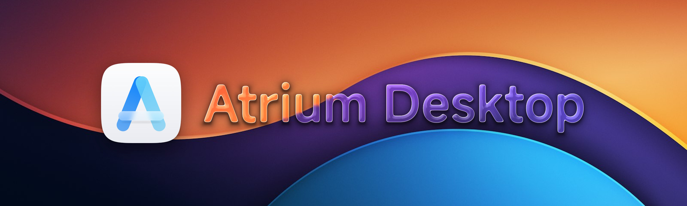
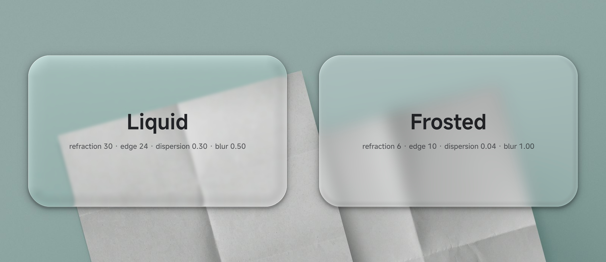
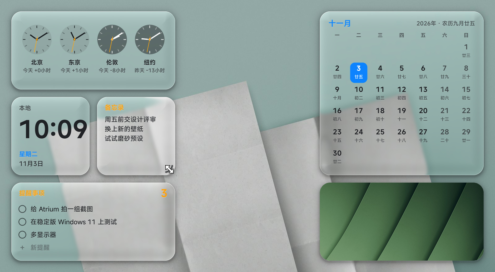
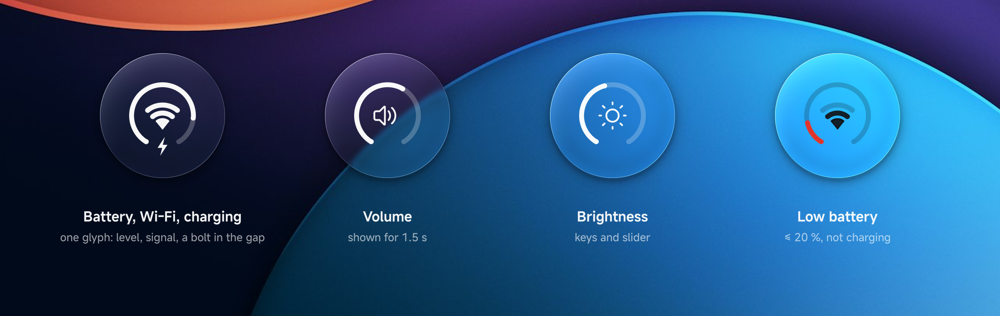
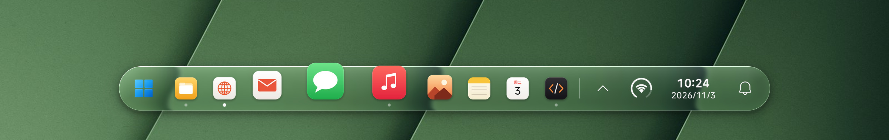

<p align="center">
  
</p>

<h1 align="center">Atrium Desktop</h1>

<p align="center">
  <b>A new desktop layer for Windows 11.</b><br>
  The taskbar, start menu, control centre, notifications and desktop widgets share one piece of real-time refracting glass, one motion system and one typeface.
</p>

<p align="center">
  <a href="#quick-start"><b>Quick start</b></a>&nbsp;&nbsp;·&nbsp;&nbsp;<a href="#design-language"><b>Design language</b></a>&nbsp;&nbsp;·&nbsp;&nbsp;<a href="#engineering"><b>Engineering</b></a>&nbsp;&nbsp;·&nbsp;&nbsp;<a href="README.md"><b>简体中文</b></a>
</p>

<p align="center">
  <a href="https://github.com/wynter-yaxley/atrium-desktop/actions/workflows/build.yml"></a>
  
  
  
  <a href="LICENSE"></a>
</p>

<br>

## More than a taskbar

The Windows desktop is several generations of design stacked on top of each other: the taskbar, the tray, the start menu, notifications and quick settings each have their own corners, type sizes and animations. Atrium redraws the whole layer you look at every day, and every part of it follows the same rules:

- **Three independent modules.** The taskbar, the desktop widgets and Stage Manager each turn on and off on their own, so you can use just one of them. With the taskbar off, Windows' own taskbar and notification banners work as usual, and the widgets and Stage Manager are unaffected. The three switches are on their pages in the settings app and in the menu of Atrium's tray icon.
- **One material.** The bar, every popup, every context menu, every notification card and every widget use the same shader with the same parameters. Change the transparency once and the whole desktop follows.
- **One motion system.** Popups move on springs; whatever follows the pointer approaches it exponentially. Every animation can be interrupted, and none depends on the frame rate.
- **One typeface.** All text is set in three weights of MiSans, figures are always tabular, and small type on glass is set one weight heavier.

Explorer and the Windows shell stay as they are. Atrium injects no code into any system process, changes no system files, installs no services and needs no administrator rights. By default it runs next to the Windows taskbar; if you want Atrium alone, the settings can hide the Windows taskbar, which comes back when Atrium exits.

<table>
  <tr>
    <td width="25%" valign="top"><b>Taskbar</b><br><sub>A floating capsule of glass. Icons swell in a wave under the pointer, like a dock; pinned and running apps can be dragged into order.</sub></td>
    <td width="25%" valign="top"><b>Start menu</b><br><sub>The Windows start menu's pins, 7 × 3 a page. Start typing to search.</sub></td>
    <td width="25%" valign="top"><b>Control centre</b><br><sub>Wi-Fi, Bluetooth, casting and projection modes, brightness, the sound output device and per-app volume.</sub></td>
    <td width="25%" valign="top"><b>Calendar</b><br><sub>Opens from the clock on the bar: the month with Chinese lunar dates and festivals.</sub></td>
  </tr>
  <tr>
    <td valign="top"><b>Notifications</b><br><sub>Every card is its own piece of glass, stacked upwards and unfolding. Windows notifications, WeChat and Feishu messages can come in as cards.</sub></td>
    <td valign="top"><b>Tray</b><br><sub>Atrium's own tray panel. It reads the system tray's icons and forwards clicks to the apps themselves.</sub></td>
    <td valign="top"><b>Desktop widgets</b><br><sub>Eight kinds in three sizes. They snap to a grid and resize from a grip on the corner.</sub></td>
    <td valign="top"><b>Settings</b><br><sub>A three-column WinUI 3 workspace around a live preview rendered from the real parameters.</sub></td>
  </tr>
</table>

<br>

## One glass, two characters

<p align="center">
  
</p>

Atrium's glass is one pixel shader built on a signed distance field ([`glass.hlsl`](native/core/render/shaders/glass.hlsl)). Every frame it takes what is behind the glass from desktop duplication, then works through these steps:

1. **Shape**: the distance field of a rounded rectangle gives the normal at the edge, and the antialiasing.
2. **Lens**: in a band along the edge, samples are pushed inwards along a circular cross-section, so the picture bends at the rim.
3. **Dispersion**: red, green and blue are pushed slightly different distances, which leaves a fine coloured fringe.
4. **Blur and vibrancy**: a few taps on a coarse mip blur the backdrop, the colour is lifted a little as on macOS, then the tint is mixed in.
5. **Light**: a crisp specular line on the side facing the light, a softer glow inside it, a faint sheen from the top, and a soft shadow around it.

Liquid and Frosted are not two implementations, only two sets of parameters for the same pipeline:

| Parameter | Liquid (default) | Frosted |
| :--- | ---: | ---: |
| Transparency | 0.95 | 0.80 |
| Blur | 0.50 | 1.00 |
| Refraction | 30 | 6 |
| Refracting edge width | 24 | 10 |
| Dispersion | 0.30 | 0.04 |
| Highlight | 0.80 | 0.45 |
| Tint | `#FFFFFF` | `#F5F5FA` |

The ink on the glass follows what is behind it: dark ink once the brightness passes 0.50, light ink again below 0.42. Between the two thresholds nothing changes, so the ink never flickers at the boundary, and each change fades over 450 ms. The ink is decided per region, so the icons on the left and the clock on the right can differ.

<br>

## Desktop widgets

<p align="center">
  
</p>

The widgets are the desktop's second layer of glass. Their design follows the desktop widgets of macOS Sonoma and later, with the layout and stacking reworked for Windows.

<table>
  <tr>
    <td width="22%" valign="top"><b>Grid</b></td>
    <td valign="top">Cells of 164, gaps of 16, 24 from the screen's edge. Each half of the screen packs against its own edge, with equal margins on both sides. A dragged widget floats on top; on release it snaps to the nearest free place and slides there (240 ms ease-out).</td>
  </tr>
  <tr>
    <td valign="top"><b>Three sizes</b></td>
    <td valign="top">Small 164 × 164, medium 344 × 164, large 344 × 344. A corner radius of 22, about 13 % of the side, the proportion of macOS widgets.</td>
  </tr>
  <tr>
    <td valign="top"><b>Resize by the corner</b></td>
    <td valign="top">On hover, the lower corner facing the middle of the screen shows an arc-shaped grip that follows the corner's curve: 6 inside the radius, 3.5 wide, in the secondary ink. While dragging, the size whose corner is nearest the pointer wins (the threshold is halfway between one cell and two), and the widget slides to it at once; the top edge and the outer edge stay where they are.</td>
  </tr>
  <tr>
    <td valign="top"><b>Three materials</b></td>
    <td valign="top">Chosen on the Widgets page of the settings app. <b>Follow the taskbar</b>: clear glass, with the ink the glass picks per region and only a few colours (the clock's orange second hand, the battery ring's green and red, the calendar's accent). <b>Dusk</b>: the same glass under a translucent black veil, with all text and symbols in white, after macOS's dimmed desktop widgets. <b>Colour</b>: no glass at all, opaque white faces with macOS's light-mode accents; the weather widget shows a sky that follows the weather.</td>
  </tr>
  <tr>
    <td valign="top"><b>Stacking</b></td>
    <td valign="top">Above the desktop and below every window; on top while Win+D shows the desktop. A widget window accepts only the z-order changes it makes itself, so other windows resizing or system popups appearing never lift it above your windows.</td>
  </tr>
  <tr>
    <td valign="top"><b>Content</b></td>
    <td valign="top">Clock (and world clock), digital clock, calendar (the large one has the lunar day under every date), battery, system monitor (CPU, memory, disk), notes (type straight into them, with IME support), reminders, photos (upright by EXIF, centre-cropped, a new one every 10 minutes), and weather (after macOS's: the small one the temperature and the sky, the medium one adds the next hours with sunrise and sunset, the large one five days with their temperature spans; from Open-Meteo, for where Windows' location service puts the computer or, when it is off, where the network connection is, asked past the system proxy).</td>
  </tr>
  <tr>
    <td valign="top"><b>Power</b></td>
    <td valign="top">The glass shows the live desktop by default, and each widget follows a changing desktop at most every 100 ms. The static wallpaper mode composes the glass again only when the wallpaper changes.</td>
  </tr>
</table>

<br>

## The status ring

<p align="center">
  
</p>

Instead of a row of battery, network and volume icons, the right side of the bar has one monochrome ring. It follows the iPhone's ring status bar, kept to two layers:

- **Outside**, a ring open by 64° at the bottom fills clockwise from the gap's left end with the battery level. The track is faint ink, the fill is the ink of every other mark on the bar, and there is no number. The fill turns red only at 20 % or less while not charging. While charging, a small bolt sits in the gap.
- **Inside**, the iPhone's three-step Wi-Fi: a wedge and two arcs, about 4:3. Three steps light at 60 % signal or more, two at 30 % or more, otherwise one; the unlit steps stay faint. A wired connection shows a network cable, and the whole glyph fades when offline.
- **Volume and brightness**: when either changes, by the wheel, the keys or another program, the ring moves to the new level and the centre becomes a speaker or a sun; after 1.5 s it returns to the battery and Wi-Fi. The fill moves on a spring with a slight overshoot (response 0.48 s, bounce 0.23), never linearly.

One glyph carries four states, and the bar stays quiet. Click the ring for the control centre; scroll over it to change the volume.

<br>

## Taskbar

<p align="center">
  
</p>

- **The wave.** The local scale is a raised cosine 2.3 icon pitches wide; integrating it gives every icon's position. The icon under the pointer therefore stays under the pointer, its neighbours shrink in turn, and the glass stretches with them. The default peak is 1.7×, and a magnified icon is never taller than twice the bar.
- **Concentric corners.** An icon's plate has the bar's radius minus the gap between them, so the two arcs share a centre. Popups, tray plates and the control centre's modules follow the same rule.
- **Sized by the screen.** The bar is about 6 % of the logical screen height and the icons are half the bar. Depending on the logical width, the bar is 52, 60, 64 or 68 high.
- **Window previews.** Rest the pointer on an app with windows and a piece of glass above it shows each of its windows live, with its title (DWM thumbnails). Click one to bring it to the front, middle-click or use its × to close it; a minimized window shows its last picture. The preview stays while the pointer moves onto it, and moving to another app swaps in that app's windows at once.
- **One soft hop at launch.** 480 ms, 0.32 of the icon high, on a sin² curve, so it leaves and lands at zero speed.
- **Out of the way.** When the foreground app is maximised or full screen, the bar slides off the screen and comes back when the pointer reaches the bottom edge.

<br>

## Stage Manager

After macOS's Stage Manager: the app you are using stays in the middle of the screen, and the others wait at one side, their windows standing in a column at an angle, in perspective and with shadows.

- **The front app stays.** Turned on, the app in front stays where it is and every other app's windows go to the left side of the screen (or the right). Each app's windows stand turned towards the middle of the screen with a soft shadow and the app's icon at the outer lower corner, with nothing behind them; several windows of one app stack one behind the other. The nearer the top or bottom of the screen, the more they lean, down at the top and up at the bottom, as if seen from the middle of the screen. Under the pointer they turn to face you and grow a little.
- **Flown in, flown back.** When the stage changes, a window's picture flies from where it was into the strip; click a card and the picture flies back, the window appearing as it lands, instead of Windows' minimize animation.
- **Click to swap, Shift to combine.** Click a card and it comes forward while the app that was there goes to the side. Shift-click adds it to the current set instead, and from then on the set goes and comes back together. Switching apps from the bar, with Alt+Tab or from a notification changes the stage too.
- **Always shown or on hover.** Always shown, the strip stays out and steps aside when a window covers it; on hover, it stays hidden. Either way, push the pointer to the screen's edge and the windows slide out one after another over everything else, and go back once the pointer leaves. While Stage Manager is on, desktop widgets keep to the other side.
- **Smooth under load.** Cards glide, appear and leave on springs and can be interrupted. Windows are pictured on a background thread just before they go, so the interface does not stall while Windows is animating windows.
- **Always reversible.** Waiting windows are only minimized, in Windows' own state. Turning Stage Manager off or quitting Atrium brings them all back, and an Atrium that ended unexpectedly picks them up again when it starts. Turn it on and off from the control centre, the bar's context menu or the settings' Stage Manager page, which stay in step; the page also has a demo you can click.

<br>

## Motion

Animation parameters are given the way Apple gives them: the response (the period of the undamped oscillation, in seconds) and the bounce (1 − the damping ratio). Springs are advanced by their closed-form solution, so at 60 Hz, at 144 Hz and through dropped frames an element is in the same place at the same moment. A popup's spring is cut into 12 cubic segments and played by DirectComposition, so the animation keeps going even when the UI thread is busy.

| Name | Parameters | Used for |
| :--- | :--- | :--- |
| `kPop` | response 0.36 s, bounce 0.38 | popups scaling from 0.92 to 1, peaking at only 1.0067 |
| `kSmooth` | response 0.48 s, bounce 0.23 | the status ring's fill |
| `EaseOut` | 1 − (1 − t)³ | fades, page changes, staggered lists, ink changes |
| `EaseOutBack` | s = 1.2 / 1.5 | the bar rising from the edge, the start menu's cells |
| `Approach` | in 20/s, out 11/s | hover plates, press feedback, the bar's movement |
| Launch hop | 480 ms, sin² | an app's icon while it starts |

Entrances use a spring or an ease-out; exits are shorter and never bounce. Direct responses to input finish within 100–350 ms.

<br>

## Design language

The full specification is [docs/DESIGN.md](docs/DESIGN.md) (in Chinese); every value in it comes from the code. The settings app's Design Language page is its interactive version: drag to compare Liquid and Frosted, change a superellipse's exponent, and click a curve to play it.

| Principle | Meaning |
| :--- | :--- |
| Defer to content | The glass only carries the content. Highlights, dispersion and shadow must keep text legible on any wallpaper. |
| Move like real things | Every animation can be interrupted and continues from its current position and velocity. |
| Same things, same treatment | One kind of element, one curve, one radius, one type size; new screens reuse existing values first. |

- **Typeface**: MiSans Medium, Demibold and Semibold, used by their actual weight as Regular, Medium and Semibold. Atrium loads them privately and never installs them.
- **Type ramp**: 30 / 20 / 15 / 13 / 12 / 11.5. At most three sizes per screen; hierarchy comes from opacity first, then size, and weight last.
- **Text on glass**: a halo of the opposite ink at 32–35 % opacity just below it; 12.5 and smaller one weight heavier.
- **Spacing**: 4, 8, 10, 12, 14, 16, 24.
- **Targets**: primary controls are at least 40 × 40.

<br>

## Engineering

```text
native/core   Atrium.Core      C++20 · Win32 · Direct3D 11 · DirectComposition · Direct2D · DirectWrite
settings/     Atrium.Settings  C# · WinUI 3 · .NET 10
```

- **Capture**: DXGI desktop duplication with only Atrium's own windows excluded; Windows.Graphics.Capture when it is not available. The GPU compares the new backdrop exactly with the one last presented and skips identical frames, so an idle desktop costs a few dozen frames a minute.
- **Pacing**: frame-latency waitable swap chains with a maximum latency of one frame. The render thread wakes on the compositor's clock, and no window presents more than once per frame.
- **Light**: no browser engine. Popup content is drawn with WARP instead of a second hardware device, and a popup's swap chain is released when it closes. No drawing resources are created per frame.
- **Click-through**: a click-through display window plus a shaped input window, so the shadow and the transparent corners click through to the window below.
- **Settings**: a WinUI 3 workspace whose preview is the same glass shader ported to the CPU; parameters reach the core live over a named pipe.

| Measured (Windows 11 26300, iGPU + RTX 4060 laptop, 3200 × 2000 at 200 %) | Result |
| :--- | ---: |
| Time per present with the backdrop changing every frame | p95 0.82 ms |
| Lag of the picture under the glass | p95 1 frame |
| Idle CPU (7 widgets, all three notification sources on) | about 1 % of one core |
| Core private memory (7 widgets; about 260 MB of it shared GPU memory) | about 270 MB |
| Core private memory (no widgets) | about 180–215 MB |

<br>

## Quick start

1. Download `Atrium-win-x64` from the latest successful run in [Actions](https://github.com/wynter-yaxley/atrium-desktop/actions/workflows/build.yml), or build it as below.
2. Unzip and run `Atrium.Core.exe`. The glass bar appears at the bottom of the screen; on first run it imports the pins of your Windows taskbar.
3. Click an app to open it, bring it to the front or minimise it; middle-click or Shift+click for a new window; right-click to pin, open the file location or close windows. Drag icons to reorder; drop a file on an app to open it there.
4. The Windows logo opens the Atrium start menu (just start typing to search). The status ring opens the control centre, the clock the calendar, the bell your notifications.
5. Double-click the tray icon (or right-click it and choose Appearance settings…) to open the settings: material, size, pinned apps, notifications and widgets.
6. Right-click the tray icon and choose Quit Atrium to exit completely. Atrium writes no registry keys and installs no services; its settings live in `%LOCALAPPDATA%\Atrium`.

## Building

Requires Windows 10 19041 or later (Windows 11 recommended), the .NET 10 SDK, and Visual Studio or the Build Tools with the C++ workload and a Windows SDK (CMake 3.25+).

```powershell
# Native core and settings app into the portable folder dist/Atrium (-Zip also packs it)
./tools/build.ps1
```

## Status

Atrium is usable every day and still changing quickly. Everything above is covered by end-to-end tests with real mouse and keyboard input.

| Status | What |
| :--- | :--- |
| Daily use | Taskbar, start menu, control centre, calendar, tray, Atrium notifications, desktop widgets, settings; system screenshots and recordings capture Atrium |
| Experimental | Mirroring Windows notifications as Atrium cards; WeChat and Feishu messages (read only, through their own windows) |
| Not yet verified | Multiple monitors, HDR, high refresh rates, Explorer restarts, sleep and wake, long-term stability, stable Windows 11 builds |
| Known limits | Recorders that use DXGI desktop duplication do not capture Atrium; on hybrid-GPU laptops Atrium needs one restart after its first run |

## Repository

```text
native/core    Atrium.Core: glass bar, start menu, notifications, control centre, desktop widgets, settings pipe
settings/      the settings app Atrium.Settings
tools/         build.ps1
assets/        icons, the MiSans interface face, the settings' preview photographs
docs/          design specification (DESIGN), settings pipe protocol (SETTINGS-PROTOCOL)
```


## Contributing

The most valuable contributions now are design review and feedback from other hardware and systems, especially stable Windows 11, multiple monitors and HDR. See [CONTRIBUTING.md](CONTRIBUTING.md).

## License

[MIT](LICENSE). Visually inspired by Apple's Liquid Glass; not affiliated with Apple or Microsoft.

<sub>The artwork on this page is rendered offline, not captured: the glass is a port of `glass.hlsl`, the bar, the status ring and the widgets are redrawn from the core's drawing code and metrics; the backdrops are the settings app's preview photographs (Martin Martz / Unsplash), the app icons original drawings.</sub>
