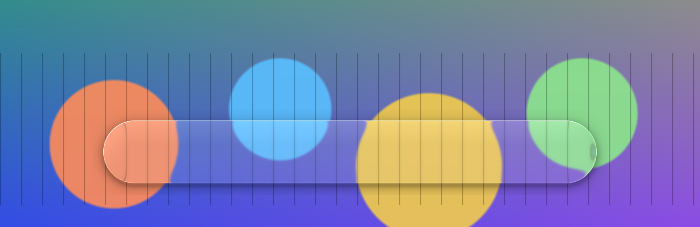
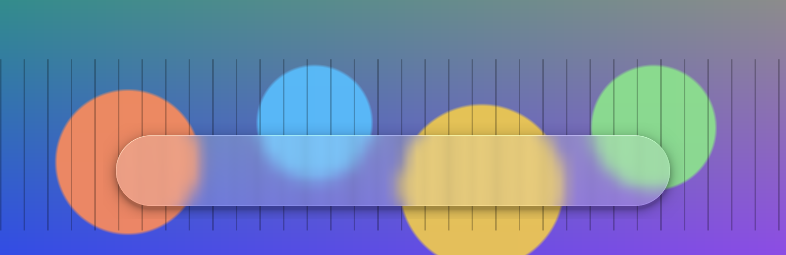

<div align="center">

# Atrium Desktop

**A native glass desktop for Windows 11**

Floating taskbar with real-time refraction · desktop widgets in one material · Explorer stays, crashes recover

[](https://github.com/wynter-yaxley/atrium-desktop/actions/workflows/build.yml)
[](LICENSE)
[](#status)
[](native/)
[](poc/)
[](docs/VERIFICATION.md)

[简体中文](README.md) | English

</div>

> [!NOTE]
> **Prototype stage; there is no installable app yet.** The first round of controlled prototypes is done and some high-risk paths are still unverified. The repository holds the architecture documents, the verification report, the probe programs and the first native component (the taskbar recovery guard).

<p align="center">
  <br>
  <br>
  <sub>Liquid and frosted presets of the same D3D11 material, rendered by <code>poc/Probe</code> over a synthetic background</sub>
</p>

## What it is

Atrium redesigns the layer you look at every day: a floating glass taskbar and a set of desktop widgets sharing one material and one design language. Explorer and the Windows shell stay in place; Start, Search, the Notification Center and Quick Settings keep working.

- **One material engine**: rounded and capsule shapes, edge refraction, subtle dispersion, GPU blur, soft highlights. Liquid and frosted looks are presets of one pipeline.
- **Native and light**: C++20, Win32, Direct3D 11, DirectComposition, DirectWrite. No browser runtime, no service, no admin rights.
- **Safe to live with**: an independent native guard restores the Windows taskbar if Atrium crashes or hangs; no injection into Explorer or DWM, no system files touched.

## Status

Both verification rounds ran on a Windows 11 build 26300 (Insider) laptop with Intel Arc + RTX 4060. Numbers: [docs/VERIFICATION.md](docs/VERIFICATION.md) (Chinese). Current decisions: [docs/DECISIONS.md](docs/DECISIONS.md).

| Area | Result |
|---|---|
| Live glass | ✅ WGC capture with self-exclusion + D3D11; iGPU frame work p95 2.4 ms, content lag p95 1 frame |
| Self-capture echo | ✅ exact comparison with the last presented backdrop; slow gradients, 1 px cursors and low-contrast scrolling text are never lost |
| Click-through | ✅ click-through visual window + region-shaped input window; shadows and transparent corners pass clicks through |
| Taskbar takeover and recovery | ✅ takeover protocol v2 + native guard, with a real AppBar: 15 fault scenarios (kill, hang, startup stall, both processes dying, lock timeout, restore not taking effect…) all restore the user's original settings (single monitor; a real Explorer restart is untested) |
| Native entry points | ✅ Start, Search, Quick Settings and Notification Center work while the Explorer taskbar is hidden |
| Third-party tray icons | ⚠️ forwarding bridge verified on normal and failure paths; Explorer restarts and real-app compatibility not yet tested |
| Desktop widgets | ✅ event-driven state machine; 13 scenarios incl. Win+D, the Show Desktop button and desktop icons (single monitor) |
| Glass in screenshots | ⚠️ built-in screenshot by default; rebuilding the backdrop from per-window captures works dynamically but still needs synthesized window shadows |
| Notification center | ⏸ deferred, not in the first release |

**Not yet verified**: multiple monitors, HDR, high refresh rates, Explorer restarts, sleep/resume, long-running stability and stable (non-Insider) Windows 11 builds.

## Repository layout

```text
docs/          architecture, current decisions, verification report, risks, roadmap (Chinese)
native/guard   native taskbar recovery guard Atrium.Guard (C++20, static CRT)
poc/Probe      verification probes: capture, glass renderer, input, taskbar, tray, widgets, recovery
poc/TrayProbe  ManagedShell comparison probe
poc/results    raw probe results (JSON)
```

## Build

Requires Windows 10 19041+ (Windows 11 recommended), the .NET 8 SDK and Visual Studio 2022 or Build Tools with the C++ workload.

```powershell
# probes
dotnet build poc/Atrium.Poc.sln -c Release

# native guard
cmake --preset win-x64 -S native
cmake --build native/build/win-x64 --config Release
```

> [!WARNING]
> Some probes hide the taskbar, inject keys and clicks, or temporarily change the taskbar auto-hide or desktop-icon settings. They wait until you are idle and restore everything afterwards; read [poc/README.md](poc/README.md) before running them.

## Contributing

Design review and probe results from other hardware are the most useful contributions right now, especially stable Windows 11, multiple monitors and HDR. See [CONTRIBUTING.md](CONTRIBUTING.md).

## License

[MIT](LICENSE). Visual inspiration comes from Apple's Liquid Glass; Atrium is not affiliated with Apple or Microsoft.
