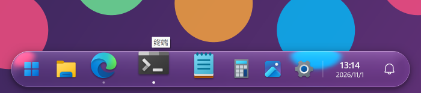
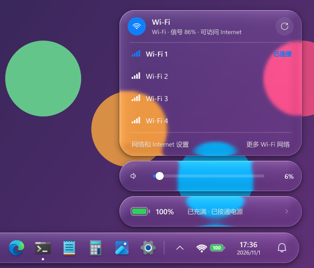
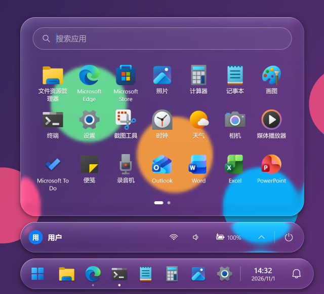
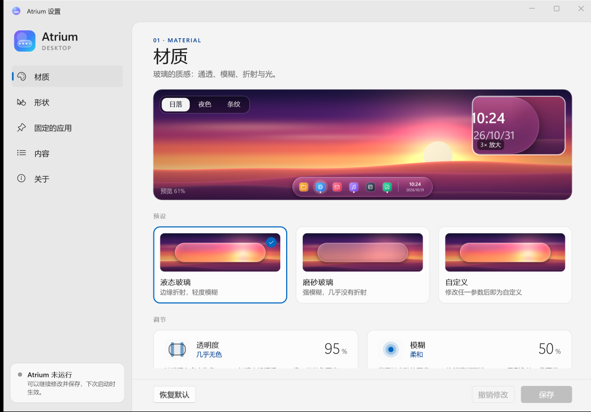
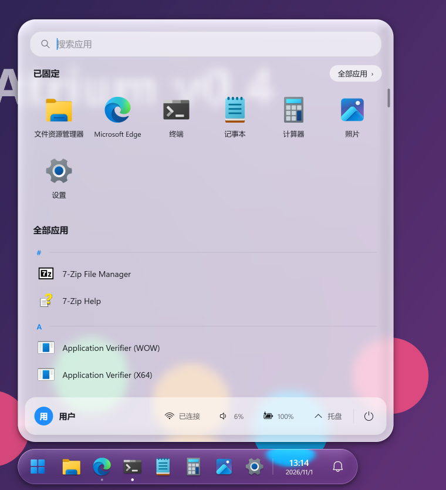
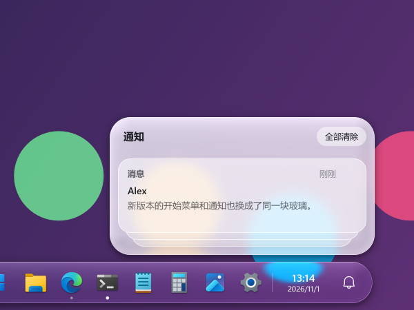
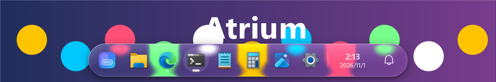
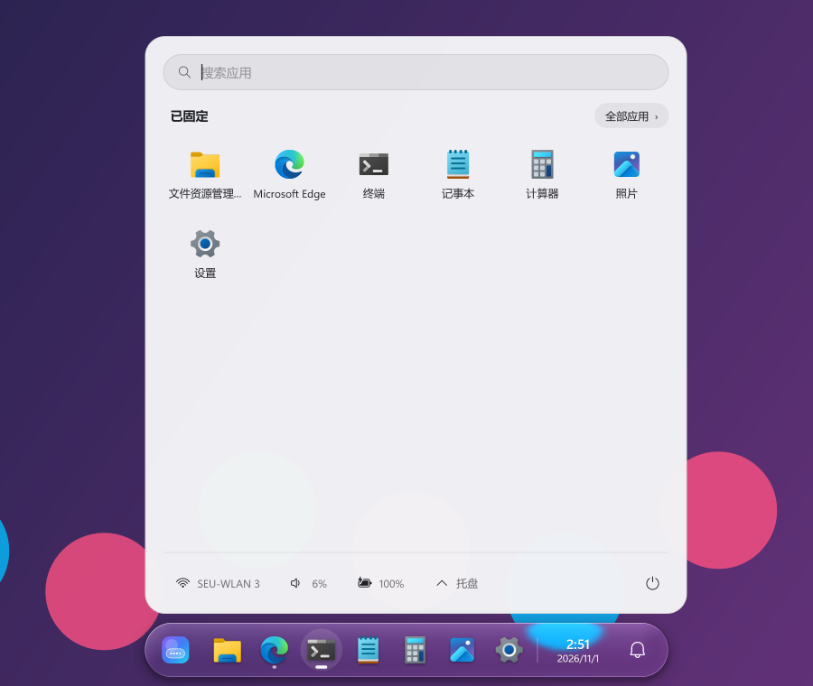
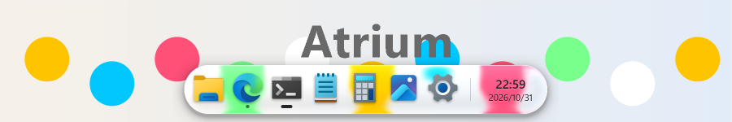
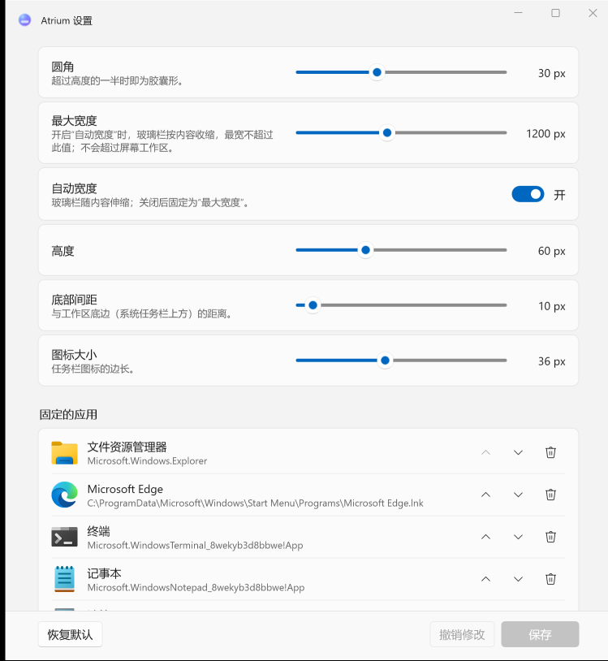

<div align="center">

# Atrium Desktop

**A native glass desktop for Windows 11**

Floating taskbar with real-time refraction · desktop widgets in one material · Explorer stays, crashes recover

[](https://github.com/wynter-yaxley/atrium-desktop/actions/workflows/build.yml)
[](LICENSE)
[](#status)
[](native/)
[](settings/)
[](docs/VERIFICATION.md)

[简体中文](README.md) | English

</div>

> [!NOTE]
> **v0.9 development build.** A C++ glass taskbar that coexists with the Windows taskbar by default, or stands alone: the Windows logo opens the Atrium start menu, pinned and running apps (drag to reorder), Atrium's own tray panel, a monochrome ring status icon (battery and Wi-Fi; the volume or the brightness while it changes) (it opens a macOS-style control centre: Wi-Fi, Bluetooth, battery, casting and projection modes, brightness, sound with the output device and per-app volume), a clock (it opens Atrium's calendar, with Chinese lunar dates), and Atrium notifications that also show Windows notifications and WeChat messages, macOS-style desktop widgets, plus a settings app in the style of macOS System Settings, with a live preview and a widget gallery. Every popup and context menu is exactly the bar's liquid glass, the interface typeface is MiSans throughout, and the icons swell like the macOS Dock under the pointer. By default it leaves the Windows taskbar alone; the settings can hide the Windows taskbar and the system notification banners so that only Atrium remains (undone when turned off or when Atrium exits).

<p align="center">
  <br>
  <sub>The icon under the pointer grows, its neighbours less and less, and the glass stretches with them; running apps have a small dot (test backdrop)</sub>
</p>

<p align="center">
  <br>
  <sub>The bar's right side: the tray entry, one status icon for Wi-Fi and battery (the level written inside the battery), the clock, notifications. The status icon opens the control centre: Wi-Fi networks in range (saved ones connect directly), a volume slider, the battery (network names hidden for the picture)</sub>
</p>

<p align="center">
  
  <br>
  <sub>Start menu: a search field and the Windows start menu's pins (7 × 3 a page), above a status capsule as high and as round as the bar; notifications: each card its own piece of glass, stacked and unfolding upwards. The material is exactly the bar's (Windows' own apps as pins for the picture; account and network names hidden)</sub>
</p>

<p align="center">
  <br>
  <sub>Settings: sidebar and cards; on top, a glass specimen rendered on the CPU from the real parameters, with a loupe on the rim's refraction and dispersion</sub>
</p>

<details>
<summary>v0.4 screenshots</summary>

<p align="center">
  
  <br>
  <sub>v0.4: the start menu with all apps grouped by initial, notifications stacked downwards, glass more frosted and tinted than the bar's</sub>
</p>

</details>

<details>
<summary>v0.3 screenshots</summary>

<p align="center">
  <br>
  <sub>Logo (start menu) · pinned and running apps · clock · notifications; icons sit on plates concentric with the bar's corners (test backdrop)</sub>
</p>

<p align="center">
  
  <br>
  <sub>Start menu: pinned apps, all apps, search, power, with network, volume, battery and the system tray at the bottom; notifications: a collapsed stack that expands on click</sub>
</p>

</details>

<details>
<summary>v0.2 screenshots</summary>

<p align="center">
  <br>
  <br>
  <br>
  <sub>On screen: liquid (strong refraction and dispersion after macOS Liquid Glass), frosted, and dark ink chosen automatically over a light backdrop (test pattern behind)</sub>
</p>

<p align="center">
  <br>
  <br>
  <sub>Hovered icons lift and show their name above; the settings app adjusts material and size live and manages pinned apps (UI in Chinese for now)</sub>
</p>

</details>

## What it is

Atrium redesigns the layer you look at every day: a floating glass taskbar with its own start menu and notifications, and a set of desktop widgets, sharing one material and one design language. Explorer and the Windows shell stay in place; the Windows Start, Search, Notification Center and Quick Settings keep working.

- **One material engine**: rounded and capsule shapes, edge refraction, subtle dispersion, GPU blur, soft highlights. Liquid and frosted looks are presets of one pipeline.
- **Native and light**: C++20, Win32, Direct3D 11, DirectComposition, DirectWrite. No browser runtime, no service, no admin rights.
- **Safe to live with**: it lives beside the Windows taskbar and never hides or replaces it; no injection into Explorer or DWM, no system files touched.

## Quick start

1. Download the `Atrium-win-x64` artifact from the latest successful run in [Actions](https://github.com/wynter-yaxley/atrium-desktop/actions/workflows/build.yml), or build it as described below.
2. Unzip and run `Atrium.Core.exe`. The glass taskbar appears at the bottom of the screen; on first run it imports your current Windows taskbar pins.
3. Left-click an app to open it, bring it to the front or minimize it; middle-click or Shift+click for a new window; right-click to pin, unpin, open the file location or close. Drag icons to reorder; drop a file on an app to open it there.
4. Click the Windows logo on the left for the Atrium start menu (type to search apps), the bell on the right for notifications, the clock for Atrium's calendar (a month with Chinese lunar dates). Icons grow under the pointer (“悬停放大”, magnification, on the 形状 (Shape) page of Settings adjusts or turns it off); the bar slides off the screen while a maximized or full-screen app is in front and comes back when the pointer reaches the bottom edge.
5. Double-click the tray icon (or right-click it → the first menu item) to open the settings: material, size, pinned apps, notifications and more.
6. Right-click the tray icon → the last menu item to quit. Nothing is written to the registry and no service is installed; settings live in `%LOCALAPPDATA%\Atrium`.

## Status

All verification ran on a Windows 11 build 26300 (Insider) laptop with Intel Arc + RTX 4060. Numbers: [docs/VERIFICATION.md](docs/VERIFICATION.md) (Chinese). Current decisions: [docs/DECISIONS.md](docs/DECISIONS.md).

| Area | Result |
|---|---|
| v0.6 tray, control centre and notification sources | ✅ Atrium's own tray panel (the system tray's icons, left and right clicks forwarded to the apps themselves), the status icon and control centre (Wi-Fi, volume, battery), Windows notifications shown as cards by default, WeChat messages (its chat list, experimental); start menu pins complete even without some environment variables; dark text over light backgrounds: tray 8, start menu 13, notifications 16 checks and the other regression tests pass |
| v0.5 start menu and notifications | ✅ the start menu shows the Windows start menu's pins (separate from the bar's), search only, pages; the status capsule shaped like the bar; each notification card its own glass, stacked upwards; popups exactly on the bar's material: start menu 13, notifications 15, motion 7 checks and the other regression tests pass |
| v0.4 motion, one material, stacking | ✅ magnification, launch bounce, press ripple, popups on the bar's glass: 7 checks; back on top after a topmost window covers it, hidden for full-screen apps, kept for maximized windows, below a revealed Windows taskbar: 5 checks; all v0.3 tests still pass |
| v0.3 taskbar, start menu and notifications | ✅ coexistence mode; real mouse and keyboard tests: taskbar 11, start menu 11, notifications 14 checks pass; settings end to end 14 and protocol 7 checks pass |
| v0.2 glass taskbar and settings | ✅ with a backdrop changing every frame, present p95 0.8 ms, about 4 % of one core, 144 MB |
| Live glass | ✅ backdrop from DXGI Desktop Duplication (Atrium's windows excluded from it alone), WGC when unavailable; D3D11; iGPU frame work p95 2.4 ms, content lag p95 1 frame |
| Self-capture echo | ✅ exact comparison with the last presented backdrop; slow gradients, 1 px cursors and low-contrast scrolling text are never lost |
| Click-through | ✅ click-through visual window + region-shaped input window; shadows and transparent corners pass clicks through |
| Taskbar takeover and recovery | ⏸ the takeover protocol and the guard's fault recovery were verified with prototypes in v0.1; Atrium only coexists with the taskbar now, and the prototypes left the repository (see git history) |
| Native entry points | ✅ Start, Search, Quick Settings and Notification Center work while the Explorer taskbar is hidden |
| Third-party tray icons | ⚠️ forwarding bridge verified on normal and failure paths; Explorer restarts and real-app compatibility not yet tested |
| Desktop widgets | ✅ v0.9.2: clock, world clock, digital clock, calendar (and a large month with Chinese lunar dates), batteries, system monitor, notes, reminders, photos; always clear glass; small, medium and large; drag to a snapping grid (its halves hug the left and right edges), drag a bottom corner or right-click to resize, right-click to remove or add; just above the desktop and under every window, on top after Win+D (single monitor) |
| Screenshots and recordings | ✅ v0.9.1: the system screenshot and tools using WGC or GDI capture the bar, popups and widgets (D36); recorders using DXGI Desktop Duplication still do not; on hybrid laptops after one restart of Atrium |
| Notifications | ✅ Atrium's own cards (queue, merge, timeout, unread, full-screen suppression, hidden text); ⚠️ mirroring Windows notifications is experimental and off by default: an unpackaged process can read and poll them, but the system banners still appear as well |

**Not yet verified**: multiple monitors, HDR, high refresh rates, Explorer restarts, sleep/resume, long-running stability and stable (non-Insider) Windows 11 builds.

## Repository layout

```text
native/core    Atrium.Core: glass bar, start menu, notifications, control centre, desktop widgets, settings pipe (C++20, D3D11, DirectComposition)
settings/      settings app Atrium.Settings (C# / WinUI 3)
tools/         build.ps1 packaging script, icon generator
tests/         end-to-end and protocol test scripts
docs/          current decisions, design specification, verification log, settings protocol, hand-over notes (Chinese)
```

The early design documents and the verification probes (`poc/`, `native/guard`) left the repository in v0.9.2; see the git history.

## Build

Requires Windows 10 19041+ (Windows 11 recommended), the .NET 10 SDK and Visual Studio or Build Tools with the C++ workload and a Windows SDK (CMake 3.25+).

```powershell
# native core and settings app into the portable folder dist/Atrium (-Zip also zips it)
./tools/build.ps1

# tests (briefly start Atrium and drive the settings window; the settings file is restored)
./tests/e2e-settings.ps1 -Package
./tests/pipe-protocol.ps1
./tests/e2e-bar.ps1          # these move the mouse, click or type; they run only after 30 s without user input
./tests/e2e-start.ps1
./tests/e2e-notify.ps1

./tests/e2e-tray.ps1
./tests/e2e-widgets.ps1
./tests/e2e-motion.ps1
./tests/e2e-stacking.ps1
```

## Contributing

Design review and test results from other hardware are the most useful contributions right now, especially stable Windows 11, multiple monitors and HDR. See [CONTRIBUTING.md](CONTRIBUTING.md).

## License

[MIT](LICENSE). Visual inspiration comes from Apple's Liquid Glass; Atrium is not affiliated with Apple or Microsoft.
