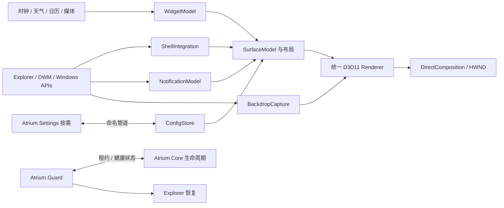

# ARCHITECTURE

> 有效决策以 [DECISIONS](DECISIONS.md) 为准，验证证据见 [VERIFICATION](VERIFICATION.md)。本文中标注 **已取代** 的内容只作历史记录。

## 1. 推荐结论与范围

采用一个负责全部可视表面的 `Atrium.Core.exe`，一个不依赖 GPU 的 `Atrium.Guard.exe`，一个按需启动的 `Atrium.Settings.exe`。托盘桥接是 Core 内的转发模块（D12），不拆成服务。（**已取代**：原计划在 ManagedShell 通过 P04 后增加 `Atrium.ShellBridge.exe`。）不创建常驻设置 WebView、插件进程群或系统服务。

Core 用 C++20、Win32、C++/WinRT；D3D11/HLSL 计算玻璃，DirectComposition 将交换链合成到窗口；Direct2D 调用 DirectWrite 绘制文字。Settings 推荐 C# / WinUI 3，用命名管道操作 Core。它不拥有 Shell 生命周期，也不拥有另一套玻璃引擎。恢复程序是独立 C++ Win32 可执行文件，已有可运行实现（`native/guard`，D10）。可视表面由可点穿的显示窗口和带形状区域的输入窗口组成（D08），渲染设备建在输出适配器上（D02）。首个纵切默认共存、不自动接管（D16）。

**信心：高（组件组合与职责），中（真实桌面采样体验），低至中（完整 Shell 替换兼容性）。** 官方合成接口和参考源码证明设计路径存在，不证明本机组合已通过。依据见 [D01–D08、R01–R09](SOURCES.md)。

产品分成明确模式：

| 模式 | 行为 | 开放条件 |
| --- | --- | --- |
| 安全共存，初始默认 | Explorer 保持可用，Atrium 为独立悬浮任务区域；禁止双重占用同一工作区 | 渲染与基本窗口测试通过 |
| 兼容替换 | 隐藏 Explorer 任务栏，自绘开始/应用/状态区；托盘通过已验收桥接或临时恢复原生栏访问 | P03、P04、P07 全过且用户明确启用 |
| 恢复模式 | 停止接管，显示 Explorer，保留设置及诊断入口 | 任一关键故障自动进入 |

安全共存是降级交付，不宣称已经满足“完整替换任务栏”。若必须持续显示完全一体化托盘，P04 失败意味着该项需求不可交付，应在评审时调整，而非长期隐藏缺失功能。

## 2. 模块与数据流

以上是职责块，不意味着全部独立库。Core 内仅保留 platform、render、shell、experience、config 五个代码域。通知和小组件是 experience 中的模型，不独立搞插件协议。一个 SceneSnapshot 包含所有表面的形状、材质、文本、图标和动画状态，按显示器提交到统一 renderer。

ShellIntegration 输出稳定的应用/窗口标识和动作，不输出 WPF 控件；BackdropCapture 输出带时间戳、适配器 LUID、坐标与色彩信息的 GPU 纹理租约；Renderer 不读注册表、不枚举任务、不调用天气服务。模型不持有 GPU COM 对象。

## 3. 线程与资源所有权

| 线程 | 工作 | 禁止事项 |
| --- | --- | --- |
| Core UI / STA，带消息循环 | HWND、输入、UI Automation、Shell 事件整合、布局、权限 UI 调度 | 不等待网络、长 GPU 操作或同步跨进程 SendMessage |
| 每个活跃适配器一个渲染线程 | 独占 D3D11 immediate context；采样纹理拷贝、绘制和 Present | 不多个线程无序使用 context；不每个小组件创建一个 device |
| 有界后台工作队列 / MTA | 文件、图标解码、网络、通知快照、可取消的数据读取 | 不直接修改 UI 模型 |
| Guard 消息/等待循环 | 等待进程句柄、超时、恢复指令、恢复快捷键 | 不依赖 Core、WinUI 或 D3D |
| Settings UI / STA | 表单、预览请求、保存状态、首启授权入口 | 不直接改 Core 正在写的配置 |

WGC 用 FreeThreaded frame pool 时，回调只取帧并交给有界最新帧槽；渲染线程负责 GPU 使用。帧对象持有至拷贝完成，及时释放，resize 时先排空旧 generation。DXGI Duplication 以零/短超时获取，不能让无变化的一个显示器阻塞另一个显示器。COM 对象按 apartment 约束使用，需要跨线程的对象遵守其敏捷性/封送要求。

模型更新合并后发布不可变快照，渲染只取最新版本；输入事件优先，过时动画帧可丢，命令确认不可丢。以 `generation` 隔离显示拓扑、device 重建及 Explorer 重启前的旧资源。健康计数必须来自 UI 和渲染线程实际完成工作，而不是一个仍然活着的假心跳线程。

## 4. IPC 与配置

首版采用本用户、当前会话的命名管道，长度前缀 UTF-8 JSON，协议版本、requestId、configRevision、类型和负载。最大消息建议 1 MiB，禁止远程客户端；ACL 限本用户及必要系统主体，检查对端 PID/会话，服务端使用首次实例限制以降低冒名管道风险。不把它描述成同一账户下的强安全隔离。无网络监听端口，无共享像素内存 IPC。

消息仅有 GetState、PreviewPatch、CommitConfig、CancelPreview、RestoreExplorer、SubscribeStatus。请求超时有明确错误，不阻塞 UI。Guard 管道另用极小白名单协议，只接受健康、接管准备、恢复；不执行任意命令。若未来桥接托盘，增加图标快照/动作协议；图标传有限尺寸 BGRA 字节或文件缓存 ID，不跨进程裸传 HICON 指针。

配置采用 `%LOCALAPPDATA%\Atrium\config.json`，带 `schemaVersion`、revision、材质参数、每显示器布局、功能开关。Core 为唯一写者：校验范围与结构 → 写同目录临时文件 → flush → 原子替换 → 保留 last-known-good。迁移为顺序的纯数据转换，保留原文件备份；遇到更新的未知 schema 只读报错，不覆盖。损坏恢复默认值，接管默认关闭。

滑块预览合并到最多每帧一次，仅更新内存；保存才写盘。Settings 断开或预览租约超时撤销未保存修改。显示器布局以稳定设备路径配合相对锚点与 DIP 保存，不能以 HMONITOR 或数组下标作为持久 ID。

恢复日志与普通配置分开：记录 session、Core PID+创建时间、Explorer 代次、改动前后状态及接管阶段；只记录本程序做过的变更。配置提交不覆盖恢复日志。

## 5. 生命周期与隐私

启动顺序：Guard 就绪 → Core 建窗、渲染和输入可用 → 校验配置 → 可选授权 → 进入共存 → 请求接管租约 → 写恢复日志 → 最后隐藏系统任务栏。接管内部已验证的事务顺序见 D09：写状态 → 切自动隐藏 → 写状态 → 隐藏任务栏 → 写状态 → AppBar；Core 通过共享内存发布心跳。退出顺序相反，先恢复 Explorer，再撤销 AppBar 和关闭自绘表面。没有健康 Guard 时不得隐藏系统任务栏。

Core 崩溃或 UI 卡死先恢复系统，不立即无限重启。Guard 被关闭时 Core 也主动恢复。两者被同时强杀、系统死锁或驱动挂死不能保证即时恢复；下次登录/启动修复遗留日志，并提供可从开始菜单、运行框启动的 `Atrium.Guard.exe --restore`。详见 [恢复状态机](WINDOWS-INTEGRATION.md)。

截图背景只保留在 GPU 中，不记录到磁盘或上传；诊断默认无窗口标题、通知正文与捕获图像。通知历史默认内存保存，锁屏时隐藏并清理可见正文。天气仅使用用户选定城市，日历首版为月历/本地事件，不暗示已接通系统所有账户；音乐用 GSMTC 的可用会话能力，不能保证所有播放器支持。天气提供商、条款和 API 密钥在对应里程碑选定，不影响底层架构。

## 6. 评审后的最小可行交付

先做单屏 SDR 60 Hz、一条悬浮栏、固定应用和运行窗口、时钟/日期、同一渲染器的双材质与参数设置、可靠恢复。任务栏替换通过闸门才启用；完整第三方托盘、Win+D 下常驻桌面层、HDR、多适配器和通知动作分别验收。最终正式支持 Windows 11 x64 的具体版本名单由测试确定，不能把本机一个开发分支当全部 Windows 11。

不依赖关闭安全功能、替换系统文件、终止 Explorer、全局注入或读取系统通知数据库。若某兼容实验需要这些条件，淘汰该路径。
