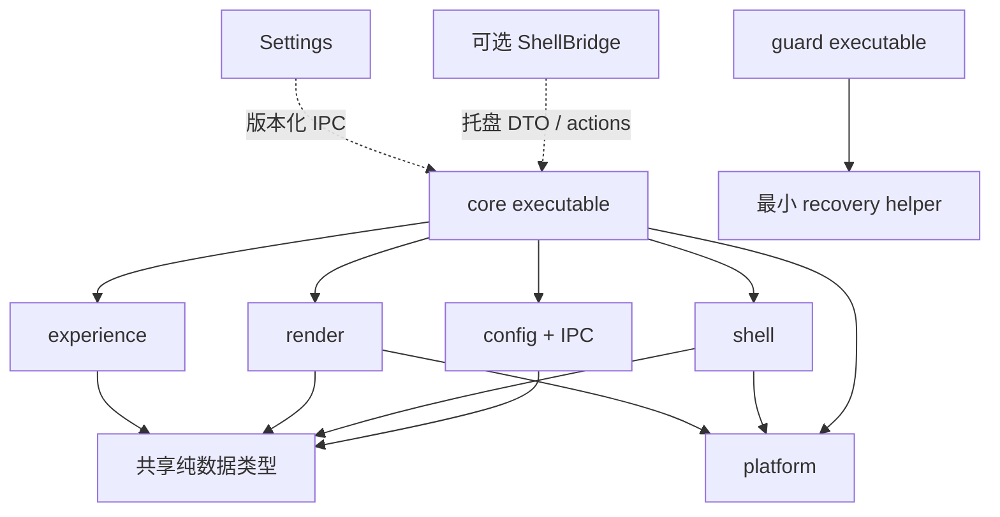

# PROJECT-STRUCTURE

本文件是建议结构，不要求现在创建目录、工程或接口实现。当前仓库包含设计文档和 `poc/` 下的 C# 验证探测程序（见 [poc/README](../poc/README.md)），产品工程尚未创建。设计原则：每个 PoC 能独立构建，不需要先搭完整应用；库边界按资源所有权和故障域划分。

## 1. 未来目录

```text
atrium-desktop/
  README.md
  docs/                         # 本次架构文档；后续 decisions/ 和 poc-results/
  CMakeLists.txt                # native 目标，不托管 XAML 编译
  CMakePresets.json             # win-x64-debug/release，显式工具链版本
  vcpkg.json                    # 最少依赖，builtin-baseline 固定
  native/
    core/                      # WinMain、应用生命周期和装配
    guard/                     # 独立恢复 EXE
    platform/                  # HWND、DPI、显示拓扑、日志、恢复小工具
    render/                    # device、capture、material、surface、scheduler
      shaders/                 # HLSL 源与打包规则
    shell/                     # windows、appbar、system actions
      compat/                  # Explorer 任务栏/桌面行为隔离
    experience/                # taskbar、widgets、notifications、UIA 与布局
    config/                    # schema、migration、atomic store、pipe protocol
  settings/
    Atrium.Settings/           # C# WinUI 3 csproj / XAML
  packaging/                   # MSIX、manifest、identity、签名与升级规则
  poc/
    capture-glass/             # P01
    composition-host/          # P02
    taskbar-recovery/          # P03、P07
    shell-tray/                # P04；需要时才有 .NET 子工程
    notification-listener/     # P05，自有测试发送器
    desktop-host/              # P06
  tests/                       # 纯数据单测和手动验收脚本/清单
  tools/                       # build.ps1、采集测量结果、验证包
```

仅当 P04 批准 ManagedShell 时，增加 `bridge/Atrium.ShellBridge/`；它不是必建目录。不建立 plugins SDK、跨平台 renderer interface、service bus 或多个玻璃框架。

## 2. 构建与依赖

native 采用 MSVC x64、C++20、Windows SDK 固定版本、CMake presets；先支持 Ninja/MSVC 或 VS generator 中的一种 CI 路径，选定后记录版本。建议首轮使用已安装且可复现的稳定工具链，不默认“latest”。OS 最低支持 build 与编译 SDK 版本分开：基础设计可在较早 Win11 API 上实现，但实际支持名单由 P09 给出；新属性用 QueryInterface/ApiInformation 探测。

静态 target：`atrium_platform`、`atrium_render`、`atrium_shell`、`atrium_experience`、`atrium_config`；可按首次实现规模合并，避免每个类一个库。可执行 target：core、guard、独立 PoC。Guard 仅链接最小恢复 helper、User32/Shell32 等，不链接 experience、D3D 或 .NET。

HLSL 首版固定 SM5 与编译器，通过 CMake custom command 生成二进制并内嵌/打包；运行时不要求编译器 DLL 才能显示任务栏。Debug 可额外支持热编译但不能成为正式运行依赖。C++ 常量缓冲区显式 alignment 和布局测试，shader 改动后做截图/数值验证，不以编译成功代替画面正确。

WinUI 3 用官方项目格式和 MSBuild、NuGet lock，C# 选经 WinUI 支持的稳定 .NET 版本，在 P08 固定；App SDK 也固定稳定版本，不拉 experimental。CMake 构建核心与 guard，可独立成功；Settings 构建不要求 core 源码同进程链接，依赖仅为协议文档/共享 schema。顶层脚本顺序编排 native → Settings → packaging，而非把两个包管理器互相嵌套。[官方样例及其版本问题](TECH-DECISIONS.md#6-issues-转化成测试而非口碑评分)。

依赖初始优先系统库；如采用 WIL/JSON 库/测试框架，固定版本并在清单说明用途。vcpkg 用于 native 三方，NuGet 用于 WinUI/.NET/C++WinRT 构建包，不能同一库重复来源。提交 lock/baseline、许可证汇总；不提交下载的 SDK、构建产物和第三方大仓库。

MSIX 包验证多 EXE 身份、capability、开机启动用户控制、安装路径只读、配置目录、签名和升级。开发 PoC 可 unpackaged，但通知身份 PoC 必须含 packaged 真路径；portable 降级明确禁用未经证明可用的通知监听。external-location package 是后备，不在首版同时维护两套发布链。

## 3. 模块依赖



不存在 render → shell 或 config → WinUI 依赖。shared model 只包含数据与小型 enum，不变成承载所有功能的“通用框架”。

## 4. 最少接口契约

以下是设计签名，不是要立即生成的 C++ 样板。

| 接口/数据 | 输入与输出 | 关键契约 |
| --- | --- | --- |
| BackdropSource | start(OutputKey, ColorMode)、tryAcquire() → FrameLease、stop | lease 带 texture、originPx、size、format/colorspace、timestamp、generation、dirty/move；不把借用帧当永恒资源；失败返回可分类状态 |
| Renderer | attach(HWND, OutputKey)、submit(SceneSnapshot)、detach | 仅渲染线程用 GPU；不可变 snapshot；资源不得跨 device generation 使用 |
| ShellModel | snapshot / events，activate(WindowKey)、launch(PinnedId) | WindowKey 不只 HWND，含 PID/创建代次；应用启动与窗口激活分开 |
| TaskbarLease | prepare → activate → release | 写恢复记录后才能隐藏；Guard 授权过期必须释放；操作可幂等回滚 |
| DesktopHostAdapter | probe → attach / detach → status | 返回 PublicTopLevel / ExperimentalDesktopChild / Unsupported，不假装总可用 |
| NotificationModel | snapshot + delta、dismissLocal、requestSystemDismiss | 系统删除单独语义；权限错误不是“没有通知” |
| ConfigStore | previewPatch、commit(expectedRevision)、cancel | 一次写者；冲突显式返回；迁移可回退 |
| HealthSnapshot | uiProgress、renderProgress、state、generation | 真实进展；静止时线程主动确认可响应；睡眠和隐藏有明确状态 |

错误仅分 Unsupported、PermissionDenied、Transient、DeviceLost、InvalidConfig、ProtocolMismatch、Fatal 等有行动含义的类别。内部 HRESULT 保留供诊断，产品文案显示下一步，不为所有函数增加无意义重试。重试集中在 capture/device/Explorer 生命周期边界。

## 5. 单模块验证与 Claude Code 任务约束

纯逻辑单测覆盖 DIP/屏幕坐标转换、SDF 参数边界、ROI 扩边、窗口分组规则、通知去重、配置迁移、恢复状态机。Capture/DirectComposition/Explorer 行为必须做真实桌面集成测试，不能用 mock 通过来宣布系统兼容。不为每个 getter 写形式化测试。

每个 Claude Code 任务必须带：目标、允许修改目录、具体 API 依据、输入/输出、非目标、构建命令、测试矩阵、失败回退、测量附件。先完成 PoC 再抽公共代码；不能从一个 hello-window 起就构建万能引擎。

未来命令形态为 `cmake --preset win-x64-debug`、`cmake --build --preset win-x64-debug --target poc_capture_glass`、`ctest --preset win-x64-debug`；当前文件不存在，**这些命令现在不可执行，也未执行**。CI 先跑编译与纯逻辑测试，专用交互式 Windows 测试机跑 GPU/Shell；普通无桌面 CI 不能承担桌面接管验收。
