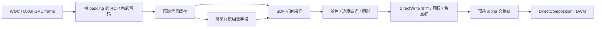

# RENDERING-DESIGN

> 有效决策以 [DECISIONS](DECISIONS.md) 为准；标注 **已取代** 的段落只作历史记录。

状态：设计与测量计划。T02–T05 的证据与信心见 [TECH-DECISIONS](TECH-DECISIONS.md)。首轮原型（`poc/Probe`）已验证：WGC + 自排除 + D3D11/DComp 液态玻璃可行，核显 0.16 ms/帧；自回声确实存在，脏区域 + 低分辨率 mip 比较可过滤；双显卡机器上 DXGI 复制要求进程在输出适配器上；逐窗口捕获可重建背景，使玻璃出现在普通截图中。详见 [VERIFICATION](VERIFICATION.md) 第 1、2 节。

## 1. Device、交换链和窗口

每个活跃物理适配器创建一个 D3D11 device（BGRA support，开发环境启用 debug layer），同适配器的表面共享 device、纹理池和着色器。枚举 DXGI adapters/outputs 并记录 LUID 与显示路径，不以“高性能 GPU”偏好代替输出归属。笔记本内屏可能在核显上，即使独显渲染算力更强也不应默认多做一次跨适配器传输。[DuplicateOutput 设备约束](https://learn.microsoft.com/en-us/windows/win32/api/dxgi1_2/nf-dxgi1_2-idxgioutput1-duplicateoutput)。

每个任务栏、独立通知面板、小组件窗口拥有可复用的 surface。首版按 HWND 创建 composition swap chain：双缓冲、`DXGI_SWAP_EFFECT_FLIP_SEQUENTIAL`、`DXGI_SCALING_STRETCH`、预乘 alpha，SDR 用 BGRA8；创建 DComp target 和 visual，将交换链设为 content。Present 交付像素，Commit 交付 visual 属性，两者不是同一件事。窗口用 NOREDIRECTIONBITMAP 路径验证，不默认叠加 WS_EX_LAYERED/UpdateLayeredWindow。尺寸变化排空相关引用后 ResizeBuffers，隐藏窗口不持续 Present。[交换链契约](https://learn.microsoft.com/en-us/windows/win32/api/dxgi1_2/nf-dxgi1_2-idxgifactory2-createswapchainforcomposition)。

渲染线程按适配器管理 DComp 对象的线程归属；HWND 仍由 UI 线程管理。先创建/握手，再发布 surface ID；关闭先撤销渲染引用，再销毁 HWND。透明交换链不会自动提供逐像素鼠标穿透。

## 2. 场景与双材质接口

一个 GlassMaterial 参数结构：mode、tint、tintMix、blurSigmaDip、cornerRadiusDip、edgeWidthDip、refractionDip、dispersionRatio、highlightStrength、shadow 参数。所有值有单位、边界、默认值及 revision。圆角限于半边长，折射强度同时限制最大采样偏移；不让用户设置导致无界纹理分配的数值。

`SurfaceSnapshot` 保存 shape、transform、clip、zOrder、material、content 和动画值。Frosted 将折射/色散设为零，选择较强 blur；Liquid 开启非线性位移、弱至中 blur 与局部色散。切换使用同一背景、相同坐标、相同文本，通过参数插值或两份结果短暂混合；不重建 device，不切换引擎。

Core 实时设置预览直接调整实际表面；Settings 可调用 Core 创建一个附属预览 HWND。不要在 WinUI/Qt 中复制一份近似 shader 后称其为精确预览。

## 3. 背景获取与自捕获

monitor capture 是当前显示器的合成结果，不是指定 Z-order 下所有窗口的独立纹理。所有参与屏幕采样的 Atrium 顶层视觉 HWND（包括文本、预览、其他玻璃表面）必须一致设置捕获排除，否则会出现同窗反馈或跨窗反馈。设置 API 成功还不够，需移动高对比背景实测排除区域确实含有下面应用，而非黑块、陈旧帧或 Atrium 残影。[SetWindowDisplayAffinity](https://learn.microsoft.com/en-us/windows/win32/api/winuser/nf-winuser-setwindowdisplayaffinity)。

WGC 首选 `CreateForMonitor`，IsSupported/可选接口运行时检查；CreateFreeThreaded 使用小帧池，初始 2 帧，队列只保留最新帧。尺寸改变重建 frame pool；ContentSize 与纹理实际尺寸分别处理。捕获边框能否移除取决于系统和授权；拒绝无边框时，明确选择带指示运行或降级，不绕过权限。[WGC](https://learn.microsoft.com/en-us/windows/apps/develop/media-authoring-processing/screen-capture)、[monitor interop](https://learn.microsoft.com/en-us/windows/win32/api/windows.graphics.capture.interop/nf-windows-graphics-capture-interop-igraphicscaptureiteminterop-createformonitor)、[无边框授权](https://learn.microsoft.com/en-us/uwp/api/windows.graphics.capture.graphicscapturesession.isborderrequired)。

DXGI backend 每输出一个 duplication；必须 ReleaseFrame，不能长期借用上帧 surface。需要持久内容时拷贝到自有 GPU texture。先应用 move rect 再 dirty rect，移动重叠区用临时纹理避免覆盖源；也可首版直接复制新帧 ROI 保证正确，验证后再做增量。处理输出旋转与虚拟桌面负坐标。指针不重复绘入玻璃，测试硬件/软件指针差异。[Desktop Duplication](https://learn.microsoft.com/en-us/windows/win32/direct3ddxgi/desktop-dup-api)。

**不可回避的冲突：** WDA 排除也影响支持该机制的外部录屏；没有按调用方区分的开关。默认实时模式应明确说明截图行为。提供“录屏兼容模式”：关闭实时采样，切换壁纸/着色降级，再解除排除；不可仅解除排除继续采样。提供程序内“导出 Atrium 效果图”可离屏合成，但不能冒充系统完整截图。不能靠每帧隐藏/显示窗口取背景，容易闪烁并破坏交互。

**已取代（D14，不再使用桌面子窗口）：** **桌面子窗口冲突：** WorkerW 下的 child 不适用顶层 HWND 的排除契约；也可能采到盖在组件前面的应用。该模式首选壁纸来源。若产品要求桌面层真实实时背景，也必须单独证明正确层级输入和无反馈，不能直接复用任务栏 monitor capture 假定正确。

## 4. GPU 光学计算

以局部像素坐标 p、半尺寸 b、半径 r 定义圆角矩形：`q = abs(p) - (b-r)`，`d = length(max(q,0)) + min(max(q.x,q.y),0) - r`。r 用 DIP 转换；遮罩以 `fwidth(d)` 估计像素足迹做 smoothstep，避免 200% DPI 和亚像素动画锯齿。复杂形变采用连续参数或平滑 SDF 合并，避免用不匹配形状直接线性混合引发拓扑跳变。

Liquid 的边缘距离 `s=max(-d,0)`；定义有限宽度厚度曲线 h(s)，法线由其空间梯度构造。位移 `Δ = k * profile(s) * normalized(∇d)`，profile 在边缘区域非线性变化、内部趋稳；梯度为零时位移归零，避免 NaN。可进一步用折射率与曲面法线推导近似屏幕偏移，但只把它叫“屏幕空间光学近似”。按 RGB 分别以 `Δ*(1+ε)`、Δ、`Δ*(1-ε)` 采样，ε 默认很小，并限制在边缘，防止正文背景到处彩边。

Blur 在降采样 ROI 上先做可分离 Gaussian（易建立基准），大半径再以 Dual Kawase 作为优化候选；由 sigma/质量档选择 mip 或层级。折射同时使用清晰与模糊背景，根据材质选择权重。所有滤波在统一线性颜色空间执行，alpha 在对应阶段预乘，避免 gamma 模糊偏暗和边缘黑边。

采样 ROI = 可视形状边界 + 最大折射偏移 + blur kernel 支持半径 + AA 安全边界；shadow 输出还需单独扩边。不能只复制卡片矩形后对边界一律 clamp，导致边缘拉丝。ROI 在显示边界裁剪时明确使用 border extension；跨显示器首版不允许单个玻璃实体跨屏，小组件松手吸附到一个显示器。后续若要跨屏，按各输出分别渲染，接受异步采样并检测接缝。

高光由边缘法线、固定环境光方向与适度 pointer 光驱动；阴影从扩展 SDF/低分辨率遮罩生成。形变、阴影和命中轮廓共用状态。文字与图标在玻璃之后叠加，不参加折射；透明 surface 用灰度抗锯齿，避免 ClearType 依赖不透明背景形成彩边。D2D 接入同 device 的 DXGI surface，DirectWrite 做 shaping、fallback、中英文和 emoji 布局；资源状态/BeginDraw-EndDraw 与 D3D pass 串行协调。

玻璃内部最终显示色可是 `mix(采样背景, 染色, tintMix)`，其 alpha 不必等于用户“透明度”。内部若已经含完整背景却再设低 alpha，会把原始背景重复混合，稀释折射；内部可用覆盖 alpha=1，边缘用 AA coverage，高光与阴影再混合。设置文案需区分透光感与窗口整体淡出。

## 5. 帧调度与缓存

唤醒源为新 capture frame、动画 tick、输入、布局/配置变化、外部数据变化。静态文字和图标缓存；时钟分钟级刷新，不默认每秒全屏绘制。某屏无可见实时玻璃就停止对应捕获。自动隐藏完成后关闭滤波，只保留边缘唤醒输入区域；全屏游戏隐藏叠层并释放 capture。

Scene dirty 与 Capture dirty 分开：捕获变化不交 ROI 则跳过滤波，动画仅改 opacity/transform 时尽量使用合成属性；但位移、形变或位置变化须重新采样背景。脏区判断要包含 padding 和 move 的源/目标影响。WGC 缺少可用 dirty metadata 时，不伪造精确增量：新帧按可见 ROI 重绘，再测成本。可选 GPU tile hash 优化须证明收益，不在首版预建。

**现行方案（D04，V1.7）**：每个新捕获帧先拷贝 ROI，再用计算着色器把它与“最近一次实际呈现时使用的 ROI”逐像素比较（16×16 分块统计变化像素数与最大差值）；相同则不重绘，不同才重绘并把该 ROI 记为新的呈现基准；另设 2 秒最大陈旧时间。比较结果在产品中异步回读（原型同步回读，核显 p50 0.9 ms）。不再使用“与上一捕获帧比较 + 阈值”的旧方法，它会让缓慢变化永久漏绘。

WGC 帧的 `SystemRelativeTime` 在本机比回调到达晚 10–12 ms，表现为合成的目标刷新时刻，不能当作“渲染完成时间”计算延迟（V1.12）；延迟以回调到达时间和帧号计数器衡量。

原分析：捕获排除后自身 Present 仍可能产生 compositor 变更信号，不能只要收到帧就立即又 Present 形成空转。也不能直接丢弃所有落在自身矩形的 dirty rect，因为真实背景改变也在那里。先做像素/帧内容稳定性验证，采用安全的限帧与 ROI 内容对比（仅 GPU、小型统计异步回读）消除回声，不能以“self rect”猜测替代正确性。

纹理按尺寸档与格式池化，resize 使用可控容量，显存上限与最近使用淘汰。正常帧无 CPU 像素 readback、无同步等待 GPU；统计和亮度反馈用延迟 query/小 staging ring，不让文字变色每帧 Map 阻塞。低延迟目标是丢旧帧、限队列、对齐 display pacing，不是盲目 Present(0) 忙循环。

## 6. 多 GPU、HDR、设备异常

3200×2000 的一张 BGRA8 纹理约 24.4 MiB，FP16 约 48.8 MiB。两帧捕获加历史、模糊和交换链可迅速过百 MiB；缩小 ROI 不消除系统捕获帧池成本。P01 同时报 Core、DWM、capture 和独显唤醒变化。

以输出所属适配器创建资源，同屏共享；独显直连外屏另建 device/线程。跨适配器纹理不能假设普通 shared handle 零拷贝；首版不跨 GPU 共用背景，表面移屏即重新归属。GameViewer 虚拟输出逐个功能探测，不以显卡名称决定支持；失败仅降低该屏能力，不能拖垮物理内屏。

HDR capture 用 FP16/scRGB 候选，保留 >1.0 亮度，单独管理 SDR white level、tone mapping 与输出色彩空间。HDR composition swap chain 的 format/alpha/color-space 支持用 API 查询并实测；D2D/DWrite 颜色也需统一。基础 DuplicateOutput 与 DuplicateOutput1 的可选格式不混为一谈。首个发布可以只承诺 SDR；HDR 检测后关闭实时材质或受控 tone-map 到 SDR 降级，不能显示明显过曝仍标为“支持 HDR”。

device removed/reset：取消旧 generation → 释放帧池、交换链和 D2D/DComp 依赖 → 重新枚举适配器 → 重建 → 从模型还原。超时先切静态不透明安全表面，不能重建就通知 Guard 恢复系统任务栏。AccessLost 只重建捕获；锁屏/secure desktop 暂停而不是提权捕获；恢复后丢弃旧帧，显示拓扑重新核实。休眠期间不累计心跳超时，唤醒给有限恢复窗口。

## 7. 输入、可访问性和层级

任务栏/通知以不抢焦点的 top-level tool window 为起点，用户主动键盘进入时建立焦点。命中测试按真实可交互形状；阴影范围不能挡应用点击。`HTTRANSPARENT` 在跨线程/跨进程场景有约束，`WS_EX_TRANSPARENT` 也不应被当成所有窗口类型的通用输入穿透保证；P02 必测跨进程点击。必要时分离只绘制的 overlay 与精确区域输入 HWND，但先验证单窗口区域方案，避免一开始窗口成倍增加。

UIA provider 暴露按钮、列表、选中/运行状态、名称、Invoke 和焦点；支持键盘遍历、系统高对比、减少动画、文本缩放。透明度降低时自动提高文字背板对比，不能仅随背景亮度不停反转文字颜色。任务栏在普通模式按 AppBar 协调，全屏时撤销 topmost；小组件不以常驻 topmost 实现“桌面层”。

## 8. 预算与质量验收

测试基线：单屏 3200×2000 / 200% / SDR / 60 Hz，电源模式与亮度固定，显示静态桌面和动态浏览器视频各测 10 分钟，预热 60 秒；之后加 120/144 Hz、外屏、HDR和虚拟屏。

| 指标 | 首轮目标 | 测法 |
| --- | --- | --- |
| Atrium GPU 绘制 | p95 ≤3 ms，p99 ≤5 ms（60 Hz 单屏基线） | D3D timestamp/disjoint；不冒充全系统 GPU 时间 |
| 帧稳定 | 动画期间 p99 帧间隔 ≤33.3 ms，>50 ms stall 为 0（排除明确 OS 切换后另报） | PresentMon/ETW + trace |
| 背景额外滞后 | p95 ≤2 个刷新周期 | 实景帧计数背景、玻璃内外同屏高速相机对比；WDA 排除时不能依赖普通录屏 |
| 输入到可见反馈 | p95 ≤50 ms | 输入标记+ETW，必要时高速拍摄；不把 capture 到 Present 当 input-to-photon |
| 静止负载 | Core+Guard 总 CPU 平均 <0.5%（全机归一化），不持续唤醒独显 | 与关闭 Atrium 基线对比；DWM 增量另报 |
| 内存 | Core+Guard 私有工作集目标 ≤150 MiB；单屏 SDR GPU 增量目标 ≤256 MiB | 设置关闭，记录峰值/稳态；共享显存另列，不强行相加 |
| 电池影响 | 静止/视频整机功耗增量目标 ≤1 W / ≤3 W | 固定亮度电源档，多次取中位数；达不到则降帧或改默认材质 |

这些目标允许在 P01 依据证据修订，但修订须写原因，不删除失败数据。120 Hz 的帧预算单独设定，不把 60 Hz 通过当高刷通过。

视觉建立固定场景：黑白网格、细线、滚动文字、视频、明暗壁纸、玻璃叠邻、极端圆角、形变、100/125/150/200% DPI。要求无递归、无黑边、无文字抖动、边缘折射连续、内容可读。macOS 对照需要真实参考设备/合法录制、匹配尺寸与背景；在缺少对照时只能称“通过内部视觉标准”，不能签署与 macOS 等效。
