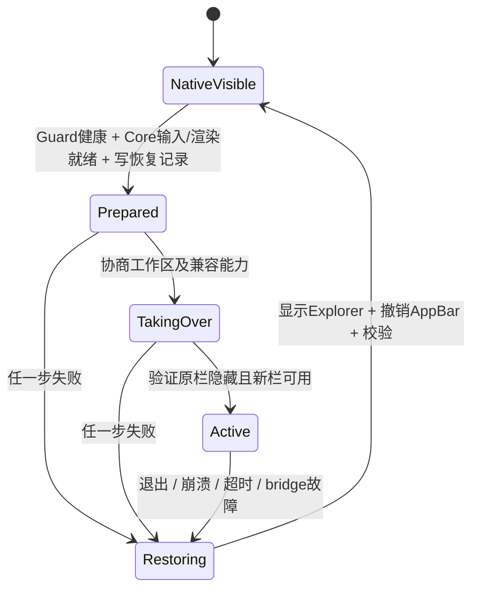

# WINDOWS-INTEGRATION

> 有效决策以 [DECISIONS](DECISIONS.md) 为准；标注 **已取代** 的段落只作历史记录。

## 1. 能力分级

“文档/源码可行”表示已取得证据，不表示已在本机执行。2026-10-31 已在一台预览版机器上执行首轮原型，下表之后的结论以 [VERIFICATION](VERIFICATION.md) 为准：任务栏隐藏与 128 ms 崩溃恢复、隐藏状态下的系统入口、转发式托盘桥接、点击后切换前台、DWM 缩略图、公开窗口方式的桌面组件均已通过；启动前已存在且不响应 `TaskbarCreated` 的托盘图标、实时通知事件仍有限制。

| 高风险事项 | 有证据的能力 | 待原型验证 | 系统级限制 |
| --- | --- | --- | --- |
| 不终止 Explorer 替换栏 | 自建 AppBar；参考实现可隐藏原生窗口 | 多屏工作区、自动隐藏竞争、系统更新重建 | 无公开“把第三方注册为完整系统任务栏”契约 |
| 开始/系统控制 | 键盘快捷键和设置 URI；原生服务继续存在 | 焦点、修饰键、弹出位置、自动隐藏交互 | 无受保证的任意坐标原生开始菜单托管 API |
| 托盘 | 应用可向系统通知区域添加自己的图标；转发式桥接正常与失败路径已测（V5.9） | Explorer 重启、真实应用兼容矩阵、提权应用 | Shell_NotifyIcon 不是第三方图标枚举/接管 API |
| 通知（延后，D15） | UserNotificationListener 读取授权范围内通知（未打包可读，V8） | 包身份对照、撤权、去重和事件时序 | 不提供通用 pre-toast 拦截或任意动作重放 |
| 桌面组件 | 普通 HWND + WinEvent 状态机，Win+D/显示桌面按钮/桌面图标已测（V7.4） | 多屏、虚拟桌面、Explorer 重启 | Explorer 桌面层嵌入无稳定公开扩展契约 |
| 崩溃恢复 | 独立进程等待/显示窗口/撤回状态 | 强杀、卡死、睡眠、更新时序 | 同时终止 Guard/Core 与系统失效无即时保证 |

## 2. 任务栏与工作区

Core 自建每屏一个 bar。AppBar 的 `ABM_NEW/QUERYPOS/SETPOS/REMOVE` 负责系统协商保留区；注册不意味着 Explorer 原栏已被替代。正常模式为底部悬浮圆角矩形，但保留工作区仍是底边一条矩形，包含悬浮间距；自动隐藏模式减少或释放保留区，边缘触发区与 Explorer 自动隐藏边冲突必须检测。[AppBar 文档](https://learn.microsoft.com/en-us/windows/win32/shell/application-desktop-toolbars)。

Explorer 兼容适配器可识别当前 shell PID 下 `Shell_TrayWnd` 和 `Shell_SecondaryTrayWnd`，保存状态后隐藏；窗口类是兼容依赖，不能因调用的是公开 ShowWindow 就把整体方案视为官方支持。不得改变 Shell 注册表、不终止 Explorer、不对 Explorer 子树随意 SetParent。查找要验证进程、类和代次，防止 HWND 复用误伤。

隐藏窗口本身不会可靠释放工作区。PoC 需要验证将 Explorer 切为自动隐藏后其工作区/边缘注册是否仍与 Atrium 冲突，随后才能协商新 AppBar。若存在同边独占自动隐藏冲突，不能用全局 SPI_SETWORKAREA 强压多显示器工作区，退回共存/非接管模式。不要照搬 ManagedShell 的 100 ms 无限重隐藏；采用事件后重验证加低频校验，设置有界失败次数，持续争夺时恢复原栏。[参考 ExplorerHelper](https://github.com/cairoshell/ManagedShell/blob/master/src/ManagedShell.AppBar/ExplorerHelper.cs)。

原栏临时恢复入口必须先让 Atrium 栏让位、撤销其保留区，再显示原栏并恢复所需状态；结束后重新运行接管事务。该路径展示整个原生栏，不能宣传为把托盘无缝嵌进玻璃内。

窗口列表以 EnumWindows 初始快照，加 `SetWinEventHook(WINEVENT_OUTOFCONTEXT)` 的 create/destroy/show/hide/name/foreground 事件；事件合并后按需重扫。不注册为系统 Shell，不加载全局 hook DLL。[WinEvent 契约](https://learn.microsoft.com/en-us/windows/win32/api/winuser/nf-winuser-setwineventhook)。

过滤 invisible、tool、owned 等窗口，结合 owner/root-owner、cloaked、虚拟桌面状态；规则不可能与 Explorer 私有任务模型完全一致。按 AUMID 优先、可验证 exe/快捷方式次之分组，不能单按进程名。Pinned 保存启动描述与用户排序，不改 Explorer 私有固定项数据库。激活使用公开窗口操作与用户手势，受 foreground lock/UIPI 限制时显示需用户处理状态，不绕过前台限制。

预览采用 DWM thumbnails，在自己的 preview HWND 展示，不每次全屏截图；生命周期和最小化/受保护窗口降级为图标。它不是可自由采样的 GPU 纹理，所以圆角复杂变形先接受矩形内容区。[DWM thumbnails](https://learn.microsoft.com/en-us/windows/win32/dwm/thumbnail-ovw)。Jump Lists、进度覆盖、任务栏按钮 IPC、Win+数字等完整原生语义不是第一阶段已承诺能力；需单列后续兼容需求。

## 3. 开始、搜索、快捷设置与通知中心

保持 Win 键等系统快捷键原生处理。自绘按钮只有在真实用户点击后，尝试公开 SendInput 触发 Win/Ctrl+Esc、Win+S、Win+A、Win+N；所有按下必须有对应释放，并检查现有修饰键，避免用户持键造成组合污染。不注册抢占这些全局快捷键。API 存在不代表目标 Shell 一定响应，UIPI、焦点和系统策略都要测。[SendInput](https://learn.microsoft.com/en-us/windows/win32/api/winuser/nf-winuser-sendinput)。

失败时提供明确的原生入口恢复与设置链接，不向私有 StartMenuExperienceHost COM 或猜测消息发送控制命令。原生菜单的弹出锚点、样式和动画由 Windows 决定；不能保证贴合浮动栏自定义布局。音量/网络/电池数据按需使用公开系统能力，自绘状态图标；它们不应被误认为 ManagedShell 托盘已经提供的第三方图标。

## 4. 第三方托盘

公开 [Shell_NotifyIcon](https://learn.microsoft.com/en-us/windows/win32/api/shellapi/nf-shellapi-shell_notifyicona) 是客户端提交协议；没有据此获得全局图标清单、回调、菜单和历史状态的受支持服务端。裁剪/重挂 Explorer 的托盘子窗口依赖内部布局、跨进程输入、DPI，不作为首选。

P04 比较两条明确路线（结论：采用第 3 条，见 D12）：

1. **保留 Explorer 持有托盘。** Atrium 提供“系统托盘”按钮临时恢复原栏，用户仍用原生图标/菜单。兼容性最佳，但打破连续一体式视觉，是公开承认的折衷。
2. **已取代：可选 ManagedShell 桥接。** 独立 C#/WPF dispatcher process 将图标数据/状态映射为 DTO，由 Core 绘制，鼠标动作在 bridge 转回。测试它是否能在不注入、不替换 Explorer 条件下正确拿到原有及新图标；审核 ITrayNotify、toolbar memory、TrayService 的实际运行路径。旧枚举路径在现代 Win11 可能不再成立。

bridge 一旦启用不是无害的只读服务：它可能更改 Explorer auto-tray 等设置或参与消息分发。必须列出实际修改、保存/恢复对应状态，并验证 bridge 崩溃时客户端图标重新注册和 Explorer 收到图标。仅显示原栏不一定恢复已经被接管丢失的 tray 状态。`TaskbarCreated` 广播是兼容恢复手段，不保证所有旧客户端都响应。P04 中任何常用应用必须重启才恢复图标，则不可作为默认可靠模式。

3. **自写转发式桥接（D12，现行）。** Core 内创建同类名窗口接收 `Shell_NotifyIcon` 消息，拷贝负载后由每个目标一个转发线程投递给 Explorer，桥接线程最多等 500 ms；Explorer 的结果原样返回应用，失败或超时一律返回 FALSE（超时后 Explorer 可能仍处理该消息，结果不确定，应用通常会在下一次 `TaskbarCreated` 时重新注册）。不改 Explorer 的 Z 序或设置；启动时向非 Explorer 的窗口逐个投递 `TaskbarCreated` 以收集现有图标；拿不到的旧图标提供“打开系统溢出区”兜底。正常路径、目标卡死、目标退出、突发、桥接中途退出均已测（V5.9）；Explorer 重启与真实应用兼容矩阵待测。

不能同时运行两个互相竞争的 tray host。要求全托盘嵌入而不接受任何私有兼容层时，当前约束下不可承诺满足。Seelen 的 hook DLL 证明有更侵入的路径，但不进入本方案。

## 5. 通知

> **延后（D15）**：首版不做通知中心，本节保留为后续设计。已知：本机未打包进程可读取通知、订阅 `NotificationChanged` 失败（V8），包身份方案未对照验证。

默认模式：右下角灵动岛形态显示 Atrium 自己的事件，第三方系统通知在授权后供用户主动展开查看；默认不对每个第三方 Toast 再自动弹一份。这样避免在无法可靠知道系统已展示情况时产生双重提醒。

通知监听使用 `Windows.UI.Notifications.Management.UserNotificationListener`；manifest 声明 `uap3:Capability Name="userNotificationListener"`，请求权限在适当 UI 线程执行，检查 Allowed/Denied/Unspecified，持续检查撤权。先验证同一 MSIX 包中 Settings 请求授权、Core 实际身份与监听可访问性；若权限关联/线程宿主不符合预期，就由 Core 建专门授权 UI，不能假设“设置程序打包了，旁边 EXE 就自动有权限”。[Listener 官方说明](https://learn.microsoft.com/en-us/windows/apps/develop/notifications/app-notifications/notification-listener)。

初始 `GetNotificationsAsync` 建快照，事件仅作为同步提示；合并并重新取快照，按会话内 notification id + app identity + creation time 去重。ID 可复用，正文相同不等于同一通知；更新、移除、应用重启及跨会话都要覆盖。允许用户清除 Atrium 的镜像；只有用户明确选择同步删除时才 RemoveNotification，绝不用“先删掉通知”实现弹出前拦截。

Listener 提供的数据不等同完整可执行 toast XML/应用回调。第三方按钮不保证可获得，更不保证可合法可靠重放。默认操作仅为展开、复制可见文本、关闭镜像、用户授权的删除、已验证的应用启动；Atrium 自己的事件才提供完整动作。应用启动不等于完成原通知动作。浏览器 Toast、自绘窗口、管理员应用、气泡、系统安全/UAC、登录界面和专用系统 flyout 均不可统称“可替换通知”。[App SDK 通知边界](https://learn.microsoft.com/en-us/windows/apps/develop/notifications/app-notifications/)。

用户可选“镜像弹出”实验：说明可能重复；或由用户在 Windows 中按应用关闭 banner 但保留通知中心，再测 Listener 数据是否仍到达。不要程序化关闭全局通知或所有声音；不能承诺勿扰时仍收到全部事件。App SDK 发送 API、MSIX 与监听权限各自独立，打包不会赋予通用拦截特权。

勿扰策略：先服从用户的 Atrium 静默开关/时段，锁屏、会议/全屏和系统不宜打扰状态不弹出。`SHQueryUserNotificationState` 是公开保守信号，**不是 Windows 11 全部 DND/优先级规则的精确镜像**；未知时默认静默镜像，仅主动展开。禁止通过私有注册表/DLL/通知数据库补齐状态后宣称稳定支持。[公开状态查询](https://learn.microsoft.com/en-us/windows/win32/api/shellapi/nf-shellapi-shqueryusernotificationstate)。

右下角定位基于目标屏 rcWork 和 Atrium 自身布局避让；尊重任务栏自动隐藏、原生面板、输入法候选和全屏状态。状态机 Collapsed → Appearing → Expanded → Dismissing，可合并同应用事件但保留条目；取消动画不能丢数据。锁屏/权限撤回立即隐藏、取消订阅并清理内存正文；不默认将通知记录到日志。

## 6. 小组件与 Explorer 桌面

**现行方案（D14）**：组件是无任务栏项、不抢焦点的顶层窗口。WinEvent 监听前台切换、最小化开始、最小化结束；桌面模式 = 所有应用窗口都已最小化且前台不是应用窗口，此时把组件置顶，离开时取消置顶并压底。只看“前台是桌面”会在用户点桌面空白处时把组件提到应用上方，前台已是桌面时按 Win+D 也不会产生前台事件，两者都已在 V7.4 修正和验证。

以下为原设计。公开基线是无任务栏项、不抢焦点的非 topmost HWND，保持普通应用之下；用户编辑时才临时提高自有编辑层，退出立即降低。仅 `HWND_BOTTOM` 不能保证在桌面图标前可见，也不保证 Win+D 后仍在原位。若公开模式在 Win+D 隐藏，可接受为降级，但不能标为已完成原生桌面层需求。

**已取代（D14）**：兼容实验 `DesktopHostAdapter` 探测当前 Explorer 的 Progman/WorkerW/SHELLDLL_DefView 关系，必要时研究社区的 0x052C 行为；它不是公开接口。不得固定一个层级/第几个 WorkerW。Rainmeter System.cpp 明确区分 24H2 前后结构，证明需结构探测与版本回归。[Rainmeter 源码](https://github.com/rainmeter/rainmeter/blob/master/Library/System.cpp)。

**已取代（D14）**：若使用 SetParent，处理 WS_CHILD/WS_POPUP、坐标转换、跨进程 DPI 影响和父窗口消失；其公开调用并不保证 Explorer 父级长期有效。[SetParent 契约](https://learn.microsoft.com/en-us/windows/win32/api/winuser/nf-winuser-setparent)。child 模式默认壁纸玻璃，原因见渲染文档。Explorer 重启立即废弃旧父句柄并隐藏组件，等新结构稳定后重建；失败恢复普通窗口/关闭桌面组件，不能持续顶置遮挡应用。

位置按 monitor ID、DIP、锚点保存，外屏拔除将不可见组件收拢到主屏安全范围；保留原屏布局供重连恢复。第一阶段时钟/日期和本地月历；天气需要 provider/缓存/错误状态，音乐走 GSMTC；不预建任意脚本插件执行系统。Win+D、显示桌面按钮、虚拟桌面切换、锁屏、桌面图标点击/拖动与 Explorer 重启必须逐项测试。

## 7. 恢复状态机

**已实现（D9/D10，协议 v2，V4.9）**：Core 创建控制块 `Local\AtriumTx-<pid>`（心跳、事务号、Guard 就绪、撤销标志）并写入同一事务号的恢复状态文件；Guard 打开 Core 进程句柄、核对启动时间与事务号、映射控制块后才发布“就绪”，任何初始化失败都不发布，Core 等不到就绪就不做任何改动。每个接管步骤（切自动隐藏 → 注册 AppBar → 隐藏任务栏）在接管锁内先检查撤销标志，再写恢复状态，再执行。恢复先置撤销标志，在锁外等待仍持有 AppBar 的 Core 退出，然后持锁、有界重试地执行并核实：任务栏可见、自动隐藏回到用户设置、工作区与接管前一致、Core 不再持有 AppBar，全部满足才写 `restored`，否则写 `restore-pending` 并返回可重试错误码；锁等待超时同样返回可重试错误，不在无锁状态下改动。卡死时 Guard 先撤销、再结束 Core，然后恢复。R1–R15 见 VERIFICATION 4.9。尚未覆盖：渲染线程单独卡死（需要渲染线程也参与心跳）、Explorer 真实重启（只做了故障注入）、睡眠唤醒、多屏。

原设计：Guard 持 Core 进程句柄（不是只看 PID），获取 UI/render 的单调进展计数。正常每秒确认一次；初始建议 UI 3 秒无响应触发恢复，正在合法休眠不计时，唤醒后给 5 秒恢复窗口。故障恢复目标见 P07。启动调试器时用显式开发模式，不能为避免误报去掉生产 watchdog。

恢复时先撤销接管租约、禁止后续隐藏动作，显示当前 Explorer taskbar，然后释放 Atrium AppBar 和恢复自己更改的自动隐藏等状态，再检查每屏工作区。Core 活着但卡死时 Guard 可在完成显示原栏后终止自己的 Core 以释放残留窗口/AppBar；不能只靠向卡死 Core 发退出消息。Guard 的独立恢复代码只复用极小 Win32 helper，不依赖渲染或托盘库。

为避免恢复与旧线程再次隐藏的竞态，所有接管变更必须核实有效租约代次；Guard 回收租约后等待/终止 Core，再重复执行幂等恢复。对已经不存在的 Explorer HWND 重新发现，不把旧 HWND 直接 ShowWindow。Explorer 未运行则等待系统重启并保留恢复 UI，不在循环里反复启动 shell。

配置日志保存 prior/owned 状态，恢复只撤销 Atrium 的改动；若用户运行中手动改了系统设置，需要比较当前值与 Atrium 写入值，避免无条件恢复很久前的值。恢复结束清理事务标志；中途断电，下次会话默认原生可见再处理日志。

为用户保留三条路径：设置中的“立即恢复系统任务栏”、Guard 注册的可配置恢复快捷键（例如 Ctrl+Alt+Shift+F12，冲突需报告）、开始菜单/运行框可启动的 `--restore`。自动重启最多有限次数，连续失败禁用接管，不能形成闪烁重启循环。更新/卸载必须先恢复，再停止进程和移除启动项；这些也是发布验收项。
